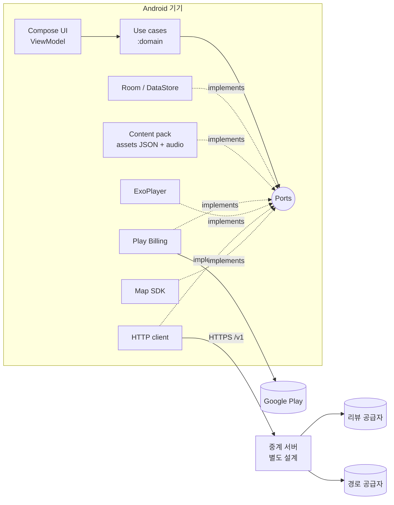
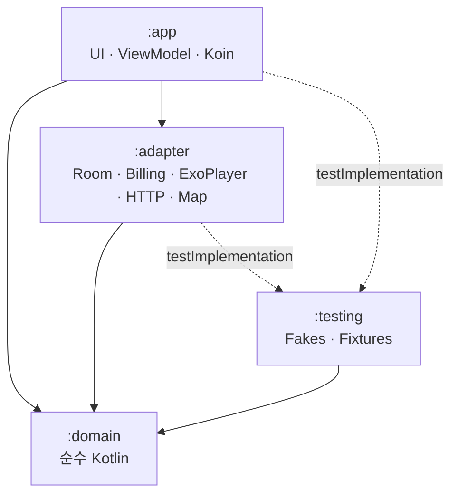

# Sign Korean Android 구현 설계서

| 항목 | 내용 |
|---|---|
| 문서 버전 | 1.0 초안 |
| 작성일 | 2026-10-20 |
| 기준 산출물 | [PRD_SRS.md](PRD_SRS.md) v2.5, 인터랙티브 프로토타입([prototype/](prototype/), [Sign_Korean_인터랙티브_디자인.html](Sign_Korean_인터랙티브_디자인.html)) |
| 목표 플랫폼 | Android (Kotlin, Jetpack Compose) |
| 지원 언어 | UI·설명 언어 **영어(`en`)·일본어(`ja`)**, 학습 대상 언어 한국어(`ko`). 이후 언어 추가 |
| 상태 | 구현 전 기술·구조 설계. §3.2의 확인 항목은 구현 전에 정한다 |

---

## 1. 목적과 적용 범위

이 문서는 PRD/SRS의 기능·품질 요구사항과 HTML 프로토타입의 화면·동작을 **Android 앱으로 구현하기 위한 기준 설계**다. 저장소·지도·결제·TTS·리뷰 공급자 같은 구현 세부를 바꿔도 학습 규칙·일정 계산·과금 규칙과 화면을 다시 만들지 않도록 경계를 정한다.

### 1.1 기준 우선순위

1. 사용자가 후속으로 명확히 요청한 사항(2026-10-20: **Android·Kotlin, 경량 헥사고날·의존성 주입·TDD, 영어·일본어 다국어**)이 가장 우선한다.
2. 그다음은 PRD/SRS v2.4의 기능 요구사항(FR), 비기능 요구사항(NFR), 검수 시나리오(AT), 화면(SC), 공통 규칙(UX)이다.
3. HTML 프로토타입은 **동작·시각 기준**이다. 프로토타입 안의 샘플 리뷰, 개략 지도, 결제 시뮬레이션, 브라우저 음성합성은 목업이며 구현 규칙이 아니다.
4. PRD와 이 문서가 충돌하면 이 문서를 적용하고, PRD에 반영할 변경을 §1.3에 기록한다.

### 1.2 제품 범위 (P0)

- **여행 계획(1순위, 유료)**: 날짜별 일정, 방문 순서·체류 시간 편집, 지도 경로·시간, 일정별 간판 학습
- **간판 학습(2순위, 무료)**: Basics 100장 + 장소 유형 간판 35장, Tinder식 카드, 복습, Undo, 세션 결과, 발음(표기 + 사전 생성 음성)
- **장소 탐색(무료)**: 지역 8개, 등록 장소 49곳, 아래 스와이프로 열리는 "이 간판을 볼 수 있는 장소" 목록, 리뷰
- **공통**: 북마크(무료 5개·유료 무제한), 인앱 결제·복원, 기기 내 저장, 오프라인 학습, 다국어

### 1.3 PRD 변경이 필요한 항목

아래 사항은 **PRD v2.5(2026-10-20)에 반영했다.** 표는 무엇을 왜 바꿨는지의 기록으로 남긴다.

| PRD 위치 | 현재 | 변경 |
|---|---|---|
| §2.3 초기 제외 | "영어 외 UI 언어" 제외 | **영어·일본어 출시**, 언어 추가를 구조로 보장 |
| §6.1, §13 | UI 전체 영어, 리뷰는 영어 | UI·설명·리뷰 언어 = 사용자 언어. 리뷰 언어 대체 규칙(§8.6) |
| §10.2 SignCard | `en_meaning`, `en_note` | 언어별 `meaning`, `note`, `reading`(발음 보조 표기). §8.4 |
| §10.2 Place·Area | `en_name` | 언어별 `name` |
| §3.4 과금 상태 | `free` / `paid` 두 가지 | **권한**은 두 가지로 유지하고, **결제 진행 상태**(대기·실패 등)는 권한과 분리해 별도로 모델링(§6.4) |
| §14.1 SC21 가격 | `US$0.99` 고정 문구 | 스토어가 돌려준 현지 가격 문자열을 표시(예: ¥150). 가격을 문구에 박아 넣지 않음 |
| UX05 기본 카피 | 영어 형식 고정 | 날짜·시간·거리·소요 시간은 언어별 형식(§8.5). en 형식은 UX05 그대로 |
| §3.4 권한 확인 시점 | 앱 시작 1회 + 결제·복원 직후 1회 | **앱이 전면으로 돌아올 때(onResume)도 1회** 확인. 앱 밖에서 끝나는 결제(편의점 결제 대기)를 반영하기 위함(§6.4) |
| NFR10, §10.3 콘텐츠 배포 | 첫 실행 시 필요한 콘텐츠만 내려받고 진행률 표시 | MVP는 콘텐츠 팩 전체를 앱에 **내장**한다(135장·오디오 10MB 이하라 내려받기 단계가 필요 없음). 원격 갱신·부분 내려받기는 P1에서 `ContentUpdateSource`로 추가하고 그때 진행률 표시를 구현 |
| §15.1 | "오른쪽 판정은 재출제 규칙으로 뒤에 다시 넣는다" | v2.2 방향 변경 전 문구가 남은 오기. **왼쪽(모름) 판정**이 재출제 대상이다(§5.1). PRD 문구 수정 |

---

## 2. 핵심 설계 원칙 — 구현 시 반드시 준수

이 항목은 구현과 코드 리뷰의 **필수 규칙**이다. 위반하면 리뷰에서 반려한다.

1. **도메인은 프레임워크를 모른다.** `:domain` 모듈은 순수 Kotlin(JVM) 모듈이다. Android SDK, Compose, Room, Play Billing, Koin, 지도·TTS SDK를 import하지 않는다. 아키텍처 테스트(§9.6)로 강제한다.
2. **의존성은 안쪽을 향한다.** 도메인이 포트(interface)를 선언하고 어댑터가 구현한다. ViewModel은 유스케이스만 호출하고 DAO·SDK를 직접 부르지 않는다.
3. **경량 헥사고날.** 레이어는 **domain(규칙·포트·유스케이스) / adapter(구현) / app(UI·조립)** 세 개로 한다. 포트는 "교체 가능성 또는 테스트 격리"가 실제로 필요한 경계에만 둔다. 한 구현만 존재하고 테스트에서도 바꿀 일이 없는 클래스에 인터페이스를 만들지 않는다.
4. **조립은 Composition Root에서만.** 구현체 연결은 `:app`의 Koin 모듈에서만 한다. 클래스는 **생성자 주입**만 받는다. `KoinComponent`, `get()`을 도메인·어댑터 코드에서 쓰지 않는다. 전역 싱글턴과 서비스 로케이터를 만들지 않는다.
5. **시간·무작위·스레드도 주입한다.** `Clock`, `IdGenerator`, `CoroutineDispatcher`를 생성자로 받는다. 테스트에서 `Thread.sleep`과 실제 시계를 쓰지 않는다.
6. **TDD가 기본 개발 순서다.** 실패하는 테스트 → 최소 구현 → 정리(RED → GREEN → REFACTOR). 버그 수정은 **재현 테스트부터** 쓴다. 테스트 없이 도메인 규칙을 추가·변경한 PR은 반려한다.
7. **상태 전이는 명시적이다.** 카드 상태(unseen/learning/known), 세션, 결제 진행, 경로 계산은 정의된 전이만 허용하는 순수 함수/상태 기계로 구현한다. 임의 덮어쓰기를 금지한다.
8. **저장이 확정이다.** 학습 판정·북마크·일정 변경은 **저장 성공 후에만** 화면을 다음 상태로 넘긴다(FR07, UX02). 저장 실패 시 이전 상태를 유지한다.
9. **사용자에게 보이는 문구를 코드에 쓰지 않는다.** UI 문구는 문자열 리소스, 콘텐츠 문구는 콘텐츠 팩의 언어별 필드에서 온다. 도메인은 문구가 아니라 **오류 코드·상태 값**을 반환한다. Compose 코드는 기본 Lint가 검사하지 못하므로 커스텀 Lint 규칙으로 막는다(AR-06).
10. **번역하지 않고 현지화한다.** 영어 문구를 일본어로 직역하지 않는다. 같은 의도를 그 나라 사용자의 문화·관습에 맞춰 다시 쓴다(§8.3). 콘텐츠는 원어민 검수를 거친다.
11. **화면 상태를 명시적으로 모델링한다.** 로딩·성공·빈 상태·오류(재시도 가능 여부)·잠금·미연결(Basics)을 UI state 타입으로 표현한다. 화면이 생명주기나 SDK 콜백을 직접 소유하지 않는다.
12. **행복 경로만 테스트하지 않는다.** 저장 실패, 프로세스 종료, 중복 입력, 오래된 비동기 응답, 오프라인, 결제 대기·취소, 권한 거부, 번역 누락, 언어 전환을 테스트 케이스로 만든다.
13. **비밀값을 앱에 넣지 않는다.** 지도·리뷰·TTS·TourAPI 비밀키는 앱에 포함하지 않는다. 공개 SDK 키는 패키지명·서명 제한을 건다(NFR05).

---

## 3. 결정 사항과 확인 필요 사항

### 3.1 설계 결정

| 영역 | 결정 | 이유 |
|---|---|---|
| 언어 | Kotlin, JVM 17 바이트코드 | 사용자 요구. 도메인을 순수 Kotlin 모듈로 분리 가능 |
| UI | Jetpack Compose, 단일 Activity, Navigation Compose | 카드 제스처·애니메이션(UX12)을 선언형으로 구현하기 쉬움 |
| 최소 OS | `minSdk 30`(Android 11), 세로 고정 | NFR07 |
| DI | **Koin** (조립부 전용), 생성자 주입 | 어노테이션 처리 없이 가볍고 테스트에서 컨테이너 없이 생성자 주입 가능. 원칙 4로 사용 범위를 `:app`에 한정 |
| 모듈 | `:domain` · `:adapter` · `:app` · `:testing` (4개) | 경량 헥사고날. 기능별 모듈 분할은 빌드 시간 문제가 실제로 생길 때 재검토 |
| 로컬 저장 | Room(학습 상태·세션·북마크·여행), DataStore(설정·권한 캐시) | 다중 테이블 원자 저장(NFR03)에 트랜잭션 필요 |
| 콘텐츠 | 검수된 **콘텐츠 팩(JSON + 오디오)** 을 앱 assets에 내장. 원격 갱신은 포트만 정의하고 P1 | 오프라인(NFR06). 서버 없이도 학습 전체가 동작 |
| 음성 | 사전 생성 오디오 파일 재생(Media3 ExoPlayer), 실패 시 표기만 표시 | FR29, UX10. 재생 시점에 TTS API 호출 없음 |
| 결제 | Google Play Billing 비소모성 1회 상품. `EntitlementGateway` 포트 뒤에 격리 | FR23~27. 테스트는 가짜 게이트웨이 |
| 지도·경로 | 경로 계산은 도메인 포트 `RouteProvider`. 지도 그리기는 UI 관심사라 `:app`의 `MapRenderer` 인터페이스로 둔다. 1순위 후보 Kakao(국내 도보 경로 지원) | PRD §17.4: Google은 국내 도보 경로 미지원/저품질 |
| 리뷰·경로 중계 | 앱은 PRD §10.3의 `/v1` API 계약에만 의존. 중계 서버는 별도 설계서 | 비밀키를 서버에 두기 위함(NFR05). 서버 전까지는 가짜 어댑터로 화면 개발 |
| 저장소 위치 | 현재 저장소에 `android/` 디렉터리로 추가 | Git 이력이 평가 대상. 기획→프로토타입→앱이 한 이력에 남음 |
| 콘텐츠 ID | 프로토타입의 현재 ID 값(`b01`~`b100`, `t-palace-1`, 장소 `tongin` 등)을 **콘텐츠 팩에 명시적 데이터로 고정**한다. 프로토타입처럼 배열 순서로 ID를 계산하지 않는다 | 학습 기록·북마크가 ID로 저장되므로, 카드를 중간에 추가해도 기존 ID가 다른 단어로 바뀌면 안 됨(C-08) |
| 일본어 발음 보조 | **카타카나 읽기와 로마자를 함께** 표시하고, 카타카나를 먼저 둔다 | 일본어 한국어 교재의 관례는 카타카나. 로마자는 FR28·UX10에 따라 항상 보여야 함(§8.4) |

### 3.2 구현 전 확인이 필요한 항목

아래는 기술 설계로 대신 결정하지 않는다. 포트와 안전한 기본값으로 먼저 구현하고, 확정 전에는 운영 경로를 켜지 않는다.

| ID | 항목 | 안전한 기본값 |
|---|---|---|
| Q-01 | **일본어 콘텐츠 원어민 검수자** 확보 여부 | 검수 전 일본어 콘텐츠는 `review_status = draft`. 출시 빌드는 draft 콘텐츠가 있으면 빌드 실패(§9.5 L10N-15) |
| Q-02 | **TTS 생성 방법**(Gemini 유료 등급 / 묶음 생성 / 일일 분할) — 2026-10-19 미결 | 음성이 없는 카드는 표기만 보이고 음성 버튼은 `AudioUnavailable` 상태(§7.4). 출시 게이트는 전 카드 음성 존재(AT17) |
| Q-03 | 리뷰·경로 공급자 계약(Kakao 등)과 중계 서버 구축 일정 | `FakeReviewProvider`·`FakeRouteProvider`로 화면·상태 개발. 출시 빌드에서 가짜 어댑터 사용 시 빌드 실패 |
| Q-04 | 일본 스토어 출시 시 법적 표기(특정상거래법 표기 등)와 가격 | 가격은 스토어 현지 가격 사용. 법적 표기 화면은 설정에 자리만 확보 |

---

## 4. 시스템 구성



학습·북마크·여행 계획·권한 캐시는 **기기 안에서 완결**된다. 네트워크가 필요한 것은 리뷰, 경로, 장소 사진, 결제뿐이다. 이 넷이 실패해도 학습은 계속된다(NFR03, NFR08).

### 4.1 책임 경계

| 구성 요소 | 책임 | 하지 않는 것 |
|---|---|---|
| UI (Compose) | 렌더링, 제스처 해석 결과 전달, 접근성·언어 표현 | 학습 규칙·시간 계산·한도 판단 |
| ViewModel | UI state 조립, 유스케이스 호출, 결과→화면 상태 매핑 | 저장·SDK 호출, 사용자 문구 생성(리소스 ID만 고름) |
| Use case (`:domain`) | 하나의 사용자 의도 실행, 트랜잭션 경계 지정, 정책 호출 | Android 타입 사용 |
| Domain model / policy | 카드 큐, 세션, 일정 계산, 북마크 한도, 권한 규칙 | I/O |
| Adapter | Room·DataStore·assets·Billing·ExoPlayer·HTTP·지도 구현, DTO↔도메인 매핑 | 제품 규칙 재구현 |
| Composition root (`:app`) | Koin 모듈로 구현체 연결, 빌드 종류별(debug/release) 어댑터 선택 | 비즈니스 로직 |

### 4.2 의존성 방향



`:domain`은 어떤 모듈에도 의존하지 않는다. `:adapter`는 `:app`을 모른다. `:testing`의 가짜 구현은 프로덕션 의존성에 들어가지 않는다.

---

## 5. Android 앱 설계

### 5.1 모듈과 패키지

```text
android/
  settings.gradle.kts
  gradle/libs.versions.toml          # 버전 카탈로그 — 버전은 구현 시점에 고정
  domain/                            # Kotlin JVM 모듈. Android 의존성 없음
    src/main/kotlin/app/signkorean/domain/
      common/      Clock, IdGenerator, LocaleTag, LocalizedText, Result 타입, DomainError
      content/     SignCard, Place, Area, PlaceType, CardPlaceLinker, ContentRepository(port)
      learning/    CardState, LearningSession, QueuePolicy, SessionReducer, Judge/Undo use cases,
                   LearningStateStore(port), SessionStore(port)
      bookmark/    Bookmark, BookmarkPolicy, ToggleBookmark use case, BookmarkStore(port)
      entitlement/ Entitlement, PurchaseFlowState, EntitlementGateway(port), EntitlementCache(port)
      trip/        Trip, TripDay, TripStop, ScheduleCalculator, TripRules, TripStore(port)
      route/       Route, RouteRequest, RouteProvider(port), RouteRequestVersioning
      review/      Review, ReviewQuery, ReviewProvider(port), ReviewLanguagePolicy
      audio/       AudioClip, AudioPlayer(port)
      location/    Coordinate, LocationProvider(port)
      locale/      AppLanguage, LanguageFallback, CurrentLocale(port)
    src/test/kotlin/...              # 도메인 단위·속성 기반 테스트
  adapter/                           # Android library 모듈
    content/     AssetContentRepository, ContentPackParser, ContentPackValidator
    db/          AppDatabase, DAO, Entity, Migrations, Room*Store
    prefs/       DataStore 기반 EntitlementCache, OnboardingStore, PendingActionStore
    locale/      AppCompatCurrentLocale (언어 저장은 AppCompat이 단일 출처, §8.2)
    billing/     PlayBillingEntitlementGateway
    audio/       ExoAudioPlayer
    net/         HttpReviewProvider, HttpRouteProvider, ApiErrorMapper (PRD §10.3 계약)
    location/    FusedLocationProvider (사용자가 선택했을 때만)
  app/                               # Android application 모듈
    di/          AppModule, DomainModule, AdapterModule, DebugOverrides
    map/         MapRenderer 인터페이스 + KakaoMapRenderer(후보) — 지도 그리기는 UI 관심사
    ui/          designsystem/(색·타이포·SignPlate·LockBadge·상태 컴포넌트)
                 onboarding/ explore/ learn/ places/ reviews/ saved/ plan/ map/ upgrade/ settings/
    navigation/  화면 ID(SC01~SC21) 기반 라우트
    res/         values/(en, 기본) values-ja/ — 문자열·복수형·접근성 문구
  testing/                           # Kotlin JVM 모듈
    Fake*Store, FakeEntitlementGateway, FakeRouteProvider, FakeReviewProvider,
    FakeAudioPlayer, FixedClock, SequentialIdGenerator, ContentFixtures, PortContractTests
```

### 5.2 화면 ↔ 기능 매핑

| PRD 화면 | 패키지 | 핵심 상태 |
|---|---|---|
| SC01 첫 실행 | `ui.onboarding` | 언어 확인(기기 언어 기본), 제스처 안내, Basics 시작 제안 |
| SC02 Explore, SC03 지역·Basics | `ui.explore` | Resume 배너, 진행률 `Known x/y`, 카드 0개 빈 상태 |
| SC04 Learn | `ui.learn` | 카드 앞/뒤, 끄는 중(방향·진행도), 판정 저장 중, 저장 실패, 세션 종료 |
| SC06 결과 | `ui.learn` | known 판정 수·learning 판정 수·고유 카드 수·남은 복습 수를 각각 표시(FR08) |
| SC07 장소 상세, SC08 장소 목록 | `ui.places` | 사진(라이선스별 표시), 리뷰 요약, 잠금 버튼, Example 표시 |
| 리뷰 | `ui.reviews` | 사용자 언어 / 대체 언어 / 없음 / 불일치 / 시간 초과(FR11) |
| SC09 Saved | `ui.saved` | n/5, Unavailable 항목, 음성 버튼 |
| SC10 Settings | `ui.settings` | **앱 언어**, 발음 보조 표기, 초기화, 구매 복원 |
| SC11~SC17 Plan | `ui.plan` | 무료면 SC21, 일정·시각·미완료 구간, 오프라인 재계산 필요 |
| SC18 Map, SC19 출발지 | `ui.map` | 경로·거리·시간, 권한 거부, 해외 위치, 미지원 |
| SC20 확인 모달 | `ui.designsystem` | 세션 교체·폼 이탈·삭제·위치 권한 |
| SC21 Upgrade | `ui.upgrade` | 현지 가격, 진행 중, 대기, 성공 후 원래 동작 재개 |

### 5.3 UI 상태와 데이터 흐름

- 화면마다 `StateFlow<XxxUiState>` 하나를 노출하고, 입력은 `onAction(XxxAction)` 하나로 받는다(단방향 데이터 흐름).
- 일회성 이벤트(토스트, 화면 이동)는 `Channel` 기반 `effects`로 내보내고, 화면 회전·재구성으로 중복 처리되지 않게 한다.
- ViewModel은 **문구 대신 리소스 ID와 인자**를 상태에 담는다(`UiText.Resource(R.string.saved_quota, 3, 5)`). 문구 조립은 Compose에서 현재 언어로 한다.
- 세션 진행 상태는 Room에 있으므로, 프로세스가 종료돼도 SC02의 Resume 배너로 복구된다(FR07, PRD §14). `SavedStateHandle`에는 화면 위치 같은 가벼운 값만 둔다.

```kotlin
// 예: Learn 화면 상태 (app 모듈)
data class LearnUiState(
    val card: CardFaceUi?,            // null이면 빈 상태
    val face: Face,                   // FRONT(한국어만) / BACK(표기·음성·뜻·설명)
    val legend: Legend,               // 장소 없는 카드면 DOWN 없음 (FR31, UX11)
    val progress: Progress,           // Decisions n/10
    val saving: Boolean,              // 저장 중이면 입력 차단 (UX03)
    val error: UiText?,               // 저장 실패 시 같은 카드 유지 (FR07)
    val canUndo: Boolean,
    val bookmark: BookmarkUi,         // Saved / NotSaved / LockedAtLimit
)
```

### 5.4 디자인 시스템

화면 색·글자·간격은 디자인 시스템 **"Sign Korean"**([디자인 시스템](https://claude.ai/artifact/Hq267Dnf44Cf2DHVwmpEz2))의 토큰을 따른다. 화면 시안은 [디자인 캔버스](https://claude.ai/artifact/WDiZvUyad1Jhb2aiRrSa5n)에 있다(SC01·02·04 앞뒤·08·09·13·21). `ui.designsystem`의 Compose 테마는 이 토큰 이름을 그대로 쓴다.

| 역할 | 토큰 | 값 |
|---|---|---|
| 바탕 / 카드 / 테두리 | `paper` / `surface` / `line` | #f6f7f9 / #ffffff / #e3e6ea |
| 본문 / 보조 글자 | `ink` / `muted` | #1f2933 / #5b6672 (바탕 대비 13.8:1 / 5.5:1) |
| 주 색 (버튼·탭·링크) | `primary` · `primary-dark` · `primary-soft` | #2b4c7e · #1d3a63 · #e8eef6 |
| **알아요(✓)** | `know` · `know-soft` · `know-ink` | #1e7a4f · #e2f3e9 · #17613e |
| **몰라요(✕)**·포커스 | `accent` · `accent-soft` · `accent-ink` | #c4661f · #fdeee4 · #a8460f |
| 오류 | `danger` · `danger-soft` | #b42318 · #fdecea |
| 표지판 판 | `plate-*` 18개 | 실제 거리 표지판 색 관례(화장실 파랑, 금지 빨강 등). 학습 내용이라 바꾸지 않는다 |

- **판정 색은 색만으로 구분하지 않는다.** 알아요는 짙은 초록 채움 + 흰 ✓, 몰라요는 연한 주황 채움 + 진한 주황 ✕로 밝기 차이(4.7:1)를 두고 기호·글자를 항상 함께 쓴다(NFR04).
- `primary`는 판정에 쓰지 않는다.
- 글자 대비는 모든 조합 4.5:1 이상, 포커스 링은 3:1 이상이다(U-10과 함께 스크린샷 테스트로 확인).
- HTML 프로토타입(`prototype/styles.css`)은 v2.4까지의 초록·코랄 색을 쓰고 있다. 앱 구현의 기준은 이 표다.
- **카드는 공공 안내 표지판 틀**로 그린다(PRD §8.3, v2.6). `ui.designsystem.SignPlate(card, face)` 하나가 앞면(단어만)과 뒷면(픽토그램 + 단어)을 모두 그리며, 픽토그램은 `res/drawable/pictogram_*.xml` 벡터 세트에서 `PictogramId` 로 찾는다. 앞면 분기에서 픽토그램을 그릴 경로 자체가 없게 만든다(U-18).

### 5.5 의존성 주입

```kotlin
// app/di/DomainModule.kt — 유일한 조립 위치
val domainModule = module {
    factory { JudgeCard(get(), get(), get(), get()) }      // 포트 4개를 생성자로
    factory { ToggleBookmark(get(), get()) }
    factory { CalculateDaySchedule() }                     // 순수 계산, 포트 없음
}
val adapterModule = module {
    single<ContentRepository> { AssetContentRepository(androidContext().assets, get()) }
    single<LearningStateStore> { RoomLearningStateStore(get()) }
    single<EntitlementGateway> { PlayBillingEntitlementGateway(androidContext(), get()) }
    single<Clock> { SystemTimeClock }      // android.os.SystemClock과 이름 충돌 피함
}
```

- 단위 테스트는 Koin을 시작하지 않고 `JudgeCard(FakeLearningStateStore(), FakeSessionStore(), FixedClock(...), ...)`처럼 직접 생성한다.
- `KoinModulesTest`가 `checkModules`로 **조립 누락**만 검사한다(§9.6).
- 디버그 빌드는 `DebugOverrides` 모듈로 가짜 결제·가짜 리뷰를 켤 수 있다. **릴리스 빌드에 가짜 어댑터가 연결되면 빌드가 실패**한다(§9.6 AR-04).

---

## 6. 도메인 설계

### 6.1 콘텐츠 모델

```kotlin
@JvmInline value class CardId(val value: String)          // "b01", "t-market-1"
@JvmInline value class LocaleTag(val value: String)       // BCP 47: "en", "ja"

data class LocalizedText(private val values: Map<LocaleTag, String>) {
    fun resolve(chain: List<LocaleTag>): String? = chain.firstNotNullOfOrNull { values[it] }
}

sealed interface CardKind {
    data class Basic(val groupId: String) : CardKind      // 장소 없음 (FR31)
    data class PlaceSign(val typeId: String) : CardKind
}

data class SignCard(
    val id: CardId,
    val kind: CardKind,
    val koText: String,                 // 학습 대상. 번역하지 않는다
    val romanization: String,           // 국립국어원 로마자 표기 (FR28)
    val reading: LocalizedText,         // 언어별 발음 보조. ja = 카타카나
    val meaning: LocalizedText,         // 언어별 뜻 — 직역 금지 (§8.3)
    val note: LocalizedText,            // 언어별 문화 설명 — 직역 금지
    val pictogram: PictogramId?,        // 뒷면에만 그린다. 앞면에는 절대 그리지 않는다 (PRD FR02·§8.3)
    val audio: AudioClip?,              // null이면 음성 준비 중
    val active: Boolean,
)
```

- **카드 → 장소 연결 규칙**(PRD §10.2)은 `CardPlaceLinker` 순수 함수 하나에만 둔다: `place.typeId == card.typeId && (place.signWords == null || card.koText in place.signWords)`. 프로토타입의 `showsSign`과 같은 규칙이며, 다른 곳에서 다시 구현하지 않는다.
- **카드 활성화**(언어와 무관): 한국어 원문 + 로마자 + **기준 언어 `en`의 뜻·설명** + 검수 완료. 하나라도 없으면 비활성으로 출제하지 않는다(FR28).
- **언어별 완성도**는 활성화와 따로 본다. `ja` 필드가 비어 있어도 카드는 활성이고, `ja` 사용자에게는 `en`으로 대체 표시한다(§8.2). 대신 출시 빌드 검사가 지원 언어의 누락을 **빌드 실패**로 막는다(§8.8). 이렇게 해야 일부만 번역된 새 언어를 추가해도 영어 사용자의 카드가 꺼지지 않는다.

```kotlin
data class Area(val id: AreaId, val koName: String, val name: LocalizedText, val active: Boolean)

data class Place(
    val id: PlaceId, val areaId: AreaId, val typeId: String,
    val koName: String, val name: LocalizedText, val address: LocalizedText,
    val coordinate: Coordinate,                 // 실제 장소 좌표. 지역 중심점으로 대신하지 않음 (FR13)
    val signWords: Set<String>?,                // null이면 유형의 모든 간판
    val photo: PlacePhoto?,                     // null이면 자리 표시
    val isExample: Boolean,                     // "Example" 표시, 실제 상호처럼 보이지 않게 (PRD §2.2)
)

data class PlacePhoto(
    val url: String,
    val license: PhotoLicense,                  // KoglType1 / KoglType3(변형 금지) / Cc0 / CcBy(author)
    val source: String, val sourceUrl: String?,
)
```

- 장소 목록(SC08)의 평점·리뷰 수·리뷰 발췌는 PRD §10.3 `GET /v1/cards/{id}/places`의 요약 필드에서 온다(`PlaceSummaryProvider` 포트). 실패해도 장소 이름·사진·주소는 콘텐츠 팩으로 보여 준다.

### 6.2 학습 세션 (FR01~FR08)

세션은 **순수 리듀서**로 구현한다. 입력(판정·Undo·뒤집기)과 현재 상태를 받아 새 상태를 돌려주며 I/O가 없다.

```kotlin
data class LearningSession(
    val id: SessionId,
    val source: SessionSource,          // Category / Card / TripDay (FR21)
    val mode: Mode,                     // ALL / REVIEW
    val queue: List<CardId>,
    val current: CardId?,
    val face: Face,
    val decisions: List<JudgedCard>,    // 최대 10 (FR08)
    val decisionSeq: Int,               // 판정·Undo마다 증가. 중복 입력 판별용
    val pendingRetry: List<Retry>,      // 모름 카드: 다른 카드 3회 판정 뒤 재출제
    val undo: UndoSnapshot?,            // 직전 판정 1건만 (FR06)
)

object SessionReducer {
    fun judge(s: LearningSession, verdict: Verdict, now: Instant): Transition
    fun undo(s: LearningSession): Transition
    fun flip(s: LearningSession): LearningSession          // 판정 아님, 저장 대상 아님
}
```

| 규칙 | 구현 위치 | 근거 |
|---|---|---|
| 오른쪽 = known, 왼쪽 = learning, 아래 = 장소 목록(판정 아님), 위 = 동작 없음 | `GestureClassifier`(app, 순수 함수) → `Verdict` | PRD §4.3 |
| 모름 카드는 다른 카드 3회 판정 뒤 재출제. 부족하면 남은 카드 먼저, 그다음 "Try again" | `QueuePolicy` | §5.1 |
| 10회 판정 또는 대기열 소진 시 종료 | `SessionReducer` | FR08 |
| Undo는 직전 1건, 상태·큐·집계를 함께 복구 | `UndoSnapshot` | FR06 |
| 뒤집기·음성·북마크·장소 목록은 상태를 바꾸지 않음 | 리듀서에 해당 입력 없음 | FR29, §4.4 |

**판정 유스케이스의 저장 순서** (FR07, NFR03):

```kotlin
class JudgeCard(
    private val sessions: SessionStore,
    private val states: LearningStateStore,
    private val tx: TransactionRunner,      // 포트: Room 트랜잭션
    private val clock: Clock,
) {
    // expectedSeq: 화면이 본 세션의 판정 순번. 중복 탭·동시 호출이면 순번이 이미 올라가 있다.
    suspend operator fun invoke(sessionId: SessionId, expectedSeq: Int, verdict: Verdict)
        : Result<LearningSession, JudgeError> =
        // 읽기·비교·저장을 한 트랜잭션 안에서 한다. 밖에서 읽으면 두 호출이 같은 상태를 읽고 둘 다 저장한다.
        tx.run {
            val session = sessions.load(sessionId) ?: return@run Err(JudgeError.SessionMissing)
            if (session.decisionSeq != expectedSeq) return@run Err(JudgeError.StaleInput)  // 화면은 무시
            val t = SessionReducer.judge(session, verdict, clock.now())
            states.save(t.cardState); sessions.save(t.session)
            Ok(t.session)
        }.recover { JudgeError.SaveFailed }     // 실패하면 화면은 이전 카드에 머문다
}
```

**중복 입력 방지**: 판정 중(`saving = true`)에는 UI가 입력을 막고, 유스케이스는 트랜잭션 안에서 `decisionSeq`(세션 내 판정 순번)를 비교해 같은 순번 판정을 두 번 저장하지 않는다(AT01, NFR03). Undo도 같은 방식(순번 비교 + 단일 트랜잭션)을 쓴다. 북마크는 순번 대신 원하는 상태(저장/해제)를 넘기고 세기·검사·쓰기를 한 트랜잭션에서 한다 — 같은 입력을 두 번 받아도 한 번만 저장되고(B-03), 화면은 저장이 끝날 때까지 다시 누르는 것을 막는다(Phase 11 리뷰).

**세션 교체·출제 규칙**: 다른 카테고리·모드를 고르면 SC20 확인 뒤 현재 세션을 끝내고 새 세션을 만든다. 카드별 학습 상태는 유지한다(§5.1). 다음 카드는 항상 앞면으로 시작한다(FR02).

### 6.3 북마크 (FR12, FR27)

```kotlin
object BookmarkPolicy {
    const val FREE_LIMIT = 5
    fun canAdd(count: Int, entitlement: Entitlement): BookmarkDecision =
        if (entitlement == Entitlement.Paid || count < FREE_LIMIT) BookmarkDecision.Allow
        else BookmarkDecision.NeedsUpgrade(count, FREE_LIMIT)   // 6번째 → SC21
}
```

- 한도를 넘었다고 **기존 북마크를 지우지 않는다**. 결제 후 기존 5개를 그대로 유지한다.
- SC21에서 결제에 성공하면 보류해 둔 저장을 이어서 수행한다(PRD §14.1). 보류 동작(`PendingAction`: 카드 ID와 동작 종류)은 SC21을 열기 전에 `PendingActionStore`(DataStore)에 저장한다. 결제 화면에 있는 동안 프로세스가 종료돼도 복귀 후 이어서 수행하기 위해서다(B-07).
- 북마크 해제는 여행 일정의 장소를 지우지 않는다(FR18).
- 콘텐츠에서 사라진 카드의 북마크는 `Unavailable`로 남기고 해제만 가능하게 한다.

### 6.4 권한과 결제 (FR23~FR27, NFR09)

**권한(Entitlement)** 과 **결제 진행 상태(PurchaseFlowState)** 를 분리한다.

```kotlin
enum class Entitlement { Free, Paid }                 // PRD §3.4 — 두 가지만

sealed interface PurchaseFlowState {
    data object Idle : PurchaseFlowState
    data object InProgress : PurchaseFlowState        // 버튼 비활성, 중복 탭 차단
    data object Pending : PurchaseFlowState           // 편의점 결제 등. 권한은 아직 Free
    data object Cancelled : PurchaseFlowState         // 오류 표시 없이 복귀
    data class Failed(val reason: FailReason) : PurchaseFlowState  // "과금되지 않았음" 안내
    data object Offline : PurchaseFlowState           // 결제를 시도하지 않음
    data object Succeeded : PurchaseFlowState         // (구현 시 추가) 성공 토스트·보류 동작 재개 신호.
                                                      // 결제 화면 밖에서 Free → Paid 가 돼도 낸다
}
```

| 규칙 | 근거 |
|---|---|
| 스토어 조회 실패 시 **마지막으로 확인된 권한 유지**. 실패를 이유로 Paid를 Free로 내리지 않는다 | §3.4, NFR09 |
| 권한 확인은 앱 시작 1회 + 결제·복원 직후 1회 + **앱이 전면으로 돌아올 때 1회**(§1.3 변경) | §3.4 |
| 조회가 **성공**했는데 구매가 없으면(환불·취소) Free로 바꾼다. 조회 **실패**와 구별한다 | NFR09 |
| `PURCHASED` 수신 시 즉시 Paid로 저장하고 **구매 확인(acknowledge)** 을 수행. 확인 실패는 다음 시작 때 재시도 | Play 정책: 3일 내 확인하지 않으면 환불됨 |
| `PENDING`은 Paid로 보지 않는다. 대기 안내를 표시하고, 완료되면 Paid로 바꾼다. 대기 구매를 받으려면 Billing 클라이언트 생성 시 `enablePendingPurchases`가 필요하다 | 일본 편의점 결제 등 |
| 유료로 만든 데이터(여행, 5개 초과 북마크)는 Free로 바뀌어도 삭제하지 않고 **읽기 전용**으로 보존 | §3.4 |
| 초기화(FR16)는 권한을 지우지 않는다 | FR16 |
| 가격은 `ProductDetails`의 현지화된 가격 문자열을 그대로 표시 | §1.3 |

### 6.5 여행 계획과 일정 계산 (FR17~FR22)

`ScheduleCalculator`는 순수 함수다. 시간대는 `Asia/Seoul` 고정이며 사용자 언어와 무관하다. 기본값은 하루 출발 09:00, 장소별 체류 30분(PRD §9.2).

```kotlin
data class Leg(val from: StopId?, val to: StopId, val durationSec: Long?)   // null = 구간 실패

fun calculate(start: LocalTime, origin: Origin?, stops: List<Stop>, legs: List<Leg>): DaySchedule
// - 출발지 없음: 첫 장소 도착 = 출발 시각
// - 구간 하나라도 null이면 그 이후 도착 시각과 총합을 Incomplete로 표시 (FR20, UX04)
// - 초 단위로 합산한 뒤 화면의 분 합계를 올림
// - 날짜를 넘으면 NextDay 플래그 → 화면은 "다음 날 도착" + 일정 단축 안내
// - 분 합계를 올림하므로 구간 표시 합과 다를 수 있다는 안내를 함께 표시 (PRD §9.2)
```

- **오래된 경로 응답 무시**: 일정 변경마다 `TripDay.revision`을 올리고, 경로 요청에 revision을 실어 보낸다. 응답의 revision이 현재와 다르면 버린다(PRD §9.2, AT12).
- `TripRules`: 여행 최대 14일, 하루 최대 10곳, 같은 날 같은 장소 중복 금지, Basics·지역 묶음은 목적지 불가, 체류 0~480분 정수. 기간을 줄여 범위 밖 일정이 생기면 **저장을 막는다**(AT11).
- **경로 규칙**(FR13~15): 기본 이동 수단은 도보. 목적지는 등록 장소의 좌표만(지역 중심점 금지). 경로 실패 시 직선거리를 도보 경로처럼, 임의 속도 계산을 공급자 시간처럼 표시하지 않는다. 오프라인에서 편집한 날은 `needsRecalculation`으로 표시하고, 연결되면 **바뀐 구간만** 다시 요청한다(FR22, AT14).
- 일정 삭제는 학습 상태·북마크를 지우지 않는다(FR22). Study this day는 시작 시 카드 목록을 세션에 저장하므로, 도중의 일정 변경은 진행 중 세션에 영향이 없다(PRD §9.1).

### 6.6 포트 목록

| 포트 | 구현 (adapter) | 테스트용 (testing) |
|---|---|---|
| `ContentRepository` | `AssetContentRepository` | `InMemoryContentRepository` |
| `LearningStateStore`, `SessionStore`, `BookmarkStore`, `TripStore`, `TransactionRunner` | Room | `Fake*Store`(실패 주입 가능) |
| `EntitlementGateway` | Play Billing | `FakeEntitlementGateway`(성공·취소·실패·대기·오프라인 시나리오) |
| `EntitlementCache`, `OnboardingStore`, `PendingActionStore` | DataStore | 메모리 구현 |
| `CurrentLocale` | AppCompat 앱 언어 조회 | 고정 언어 |
| `PlaceSummaryProvider` | HTTP(`/v1/cards/{id}/places`) | 시나리오형 가짜 |
| `AudioPlayer` | Media3 ExoPlayer | `FakeAudioPlayer`(재생 기록) |
| `ReviewProvider`, `RouteProvider` | HTTP(`/v1` 계약) | 시나리오형 가짜(지연·시간 초과·0건·언어 없음) |
| `LocationProvider` | Fused Location | 거부·해외·실패 시나리오 |
| `Clock`, `IdGenerator` | 시스템 | `FixedClock`, `SequentialIdGenerator` |

---

## 7. 어댑터 설계

### 7.1 콘텐츠 팩

프로토타입의 `data.js`를 `.work/build_content_pack.py`가 JSON 팩(`adapter/src/main/assets/content/content-pack.json`)으로 바꾼다. 앱은 assets의 팩을 한 번 읽어 검사한 뒤 메모리에 둔다. 아래는 구현된 스키마 1이다.

```json
{
  "schemaVersion": 1,
  "version": "0d494671456c",
  "locales": { "en": "reviewed", "ja": "draft" },
  "areas": [{ "id": "myeongdong", "koName": "명동·남대문", "name": { "en": "Myeongdong & Namdaemun" }, "active": true }],
  "cards": [{
    "id": "b26",
    "kind": "basic", "group": "service",
    "koText": "편의점",
    "romanization": "pyeonuijeom",
    "reading": { "ja": "ピョニジョム" },
    "meaning": { "en": "Convenience store", "ja": "コンビニ" },
    "note": { "en": "편의 means convenience, 점 means shop. Most are open 24 hours.", "ja": "…" },
    "pictogram": null, "plateColor": "#5b4b8a",
    "audio": null,
    "reviewed": true
  }],
  "places": [{
    "id": "seochon-ph", "areaId": "gyeongbokgung", "typeId": "services",
    "koName": "서촌 약국", "name": { "en": "Example pharmacy · Seochon" }, "address": { "en": "…" },
    "lat": 37.579, "lng": 126.97, "signWords": ["약국"],
    "photo": { "url": "https://…", "license": { "type": "KOGL_1" }, "source": "한국관광공사", "sourceUrl": "…" },
    "isExample": true
  }]
}
```

- `version`은 내용 해시다. 내용이 같으면 값도 같아 팩을 다시 만들어도 diff가 생기지 않는다.
- `locales`는 언어별 검수 상태다. 앱이 고를 수 있는 언어 목록은 이 값에서 온다(L10N-08). `draft` 언어는 출시 검사에서 막힌다(§8.8).
- `en` 읽기 표기는 로마자 자체이므로 `reading`에는 `en`을 쓰지 않는다.
- **ID 고정**: 생성기가 `android/content-id-lock.json`(ID → 한국어 원문)을 관리한다. 잠금은 늘기만 한다. 커밋된 잠금에서 항목이 지워지거나 바뀌면 생성기가 실패하고, `BundledContentPackTest`도 같은 조건을 검사한다(C-08).
- **검사와 복구**(`ContentValidator`, 도메인 순수 함수): ID·단어 중복, 원문 앞뒤 공백, 없는 지역, Example 표시 불일치, signWords 오타, 카드 없는 장소 유형, 장소 없는 카드, 없는 픽토그램, 비활성 카드를 본다. 실행 중에는 **문제 항목만 빼거나 고친 팩으로 계속 동작**하고, 출시 빌드는 오류가 하나라도 있으면 테스트에서 막는다. 형식 오류(JSON·스키마·허용되지 않는 사진 라이선스)만 팩 전체를 쓸 수 없게 한다.
- 사진 `url`이 `asset://`이면 앱 내장 사진이다. UI가 이미지 로더에 넘기기 전에 `file:///android_asset/`으로 바꾼다.
- 오디오는 PRD §7.3 기준 **AAC(m4a) 모노**로 통일한다(Android 전 버전에서 하드웨어 디코딩). 프로토타입의 mp3는 생성 스크립트에서 변환한다.
- 원격 갱신(P1)은 `ContentUpdateSource` 포트만 정의한다. 갱신은 **세션 종료 뒤** 적용한다(PRD §5.1).

### 7.2 Room 스키마

| 테이블 | 키·제약 |
|---|---|
| `card_state` | PK `card_id`, `state` CHECK(unseen/learning/known), `last_judged_at`, `judgement_count` |
| `session` | PK `id`, `source_type`, `source_id`, `return_route`, `card_ids_snapshot_json`, `mode`, `queue_json`, `current_card_id`, `meaning_visible`, `decisions_json`, `undo_json`, `decision_seq` (PRD §10.2) |
| `bookmark` | PK `card_id`(중복 불가), `created_at` |
| `trip` / `trip_day` / `trip_stop` | FK + `ON DELETE CASCADE`. `trip_stop` UNIQUE(`day_id`, `destination_id`), `order` 정수 |

- 판정은 `card_state` + `session`을 **한 트랜잭션**으로 저장한다.
- 스키마 변경은 Room 자동/수동 마이그레이션과 `MigrationTest`로 검증한다. 파괴적 마이그레이션(`fallbackToDestructiveMigration`)은 금지한다. 학습 기록이 사라진다.

### 7.3 결제 어댑터

`PlayBillingEntitlementGateway`는 `enablePendingPurchases`를 켠 Billing 클라이언트(Billing Library 8.3, Java API)의 콜백을 suspend 함수로 감싸 `PurchaseResult`(`Purchased`, `Pending`, `Cancelled`, `AlreadyOwned`, `Unconfirmed`, `Failed(reason)`)와 `StoreQuery`(`Success(구매 목록)` / `Failure`)를 돌려준다. 복원 결과(`Restored`, `NothingToRestore`, `Failed`)는 도메인 `Entitlements.restore()` 가 구매 목록 조회로 정한다. 응답 코드 → 결과 매핑표(`BillingResponses`)를 단위 테스트로 고정한다. 연결 끊김은 지수 백오프로 재연결하되 **사용자 동작 없이 결제를 다시 시도하지 않는다.**

- 모든 콜백 대기에 시간 상한(15초)을 둔다. 결제 결과 대기는 5분이며, 지나면 `Unconfirmed` 를 돌려 도메인이 구매 목록으로 정한다(Phase 12 리뷰 ENT-01·02).
- 결제 화면 밖에서 온 구매 갱신(앱이 앞에 있는 동안 대기 결제 완료)은 `onStoreChanged` 로 알리고, 앱이 권한을 다시 확인한다.
- 권한 확인의 "전면 복귀"는 시작된 Activity 수가 0 → 1 이 되는 순간이다. 결제 화면(`ProxyBillingActivity`)은 같은 프로세스의 Activity 라 resume 마다 확인하면 결제 중에 끼어든다.
- 상품 ID 는 `full_unlock` 이다. Play Console 의 비소모성 상품 ID 와 같아야 하며, 바꾸면 기존 구매자의 복원이 끊긴다.

### 7.4 음성 어댑터

- 재생 중 다시 누르면 처음부터 재생(FR29). 다른 카드로 넘어가면 정지.
- 무음 모드·볼륨 0에서도 오류를 표시하지 않는다(UX10). 오디오 포커스는 짧은 일시 포커스를 요청한다.
- 파일이 없거나(아직 생성 전 포함) 디코딩에 실패하면 한 가지 상태 `AudioUnavailable`로 처리한다. 화면은 표기를 그대로 보여 주고 버튼을 "Audio unavailable" 상태로 바꾼다. **브라우저 음성합성 같은 기기 TTS로 대신 읽지 않는다.** 검수되지 않은 발음을 들려주게 되기 때문이다.

### 7.5 네트워크 어댑터

- PRD §10.3 계약(`/v1/places/{id}/reviews?language=`, `POST /v1/routes`)에만 의존한다. 공급자(Kakao 등) DTO는 서버에만 있다.
- 타임아웃 8초(NFR02). 오류 코드(`NO_DATA`, `UNSUPPORTED`, `RATE_LIMITED`, `UPSTREAM_TIMEOUT` …)는 `ApiErrorMapper`가 도메인 오류로 바꾼다.
- 요청에 `Accept-Language`와 `language` 파라미터로 사용자 언어를 보낸다. 리뷰 언어 대체(§8.6)는 **앱이** 한다: 사용자 언어 결과가 `NO_DATA`이면 `language=en`으로 한 번 더 요청한다(`ReviewLanguagePolicy`). 서버는 요청받은 언어만 돌려준다.
- 리뷰는 공급자가 준 **일부 목록**임을 화면에 표시한다(FR11).
- 외부 링크(원문 리뷰·외부 지도)는 허용 도메인 목록에 있는 URL만 연다(UX08).

---

## 8. 다국어 설계

### 8.1 언어의 세 가지 축

| 축 | 값 | 예 |
|---|---|---|
| **UI 언어** | `en`, `ja` (추가 가능) | 버튼, 안내, 오류 문구 |
| **설명 언어** | UI 언어와 같음 | 카드 뜻·설명·발음 보조, 장소 이름, 리뷰 |
| **학습 대상 언어** | `ko` 고정 | 간판 원문. **어떤 언어에서도 번역하지 않는다** |

### 8.2 언어 선택과 대체(fallback)

- 앱 언어는 Android **앱별 언어 설정**(per-app language)을 사용한다. 앱 안에서는 AppCompat `setApplicationLocales`로 바꾸고, Android 12 이하(API 30~32)에서는 매니페스트의 `autoStoreLocales`로 AppCompat이 저장하게 한다. Android 13 이상은 `locales_config.xml`에 `en`, `ja`를 등록해 OS 설정에서도 바꿀 수 있다. **언어 값의 저장은 AppCompat 하나만** 한다(별도 DataStore에 이중으로 저장하지 않는다).
- 지역 태그(`ja-JP`, `en-GB`, `en-US`)는 언어 부분으로 맞춘다: `ja-*` → `ja`, `en-*` → `en`.
- 첫 실행 시 기기 언어가 일본어면 `ja`, 그 외는 `en`. SC01에서 바꿀 수 있다.
- 콘텐츠 대체 순서는 `LanguageFallback`(도메인) 한 곳에서 정한다: **사용자 언어 → en**. 출시 빌드에서는 대체가 일어나면 안 된다(§8.8 검사). 대체는 원격 콘텐츠 갱신 중 일부 누락 같은 비상 상황의 안전망이다.
- 새 언어 추가 절차: `values-xx/` 리소스 추가 → 콘텐츠 팩 `locales`에 추가 → 원어민 검수 → `locales_config.xml` 등록. **코드 변경 없이** 추가되는지 테스트로 보장한다(§9.5 L10N-08).

### 8.3 현지화 원칙 — 직역 금지

1. **영어 문장을 일본어로 옮기지 않는다.** 같은 목적(무엇을 알려 주려는가)에서 출발해 일본어 화자에게 자연스러운 표현으로 새로 쓴다.
2. **설명은 학습자의 생활 경험에 기대어 쓴다.** 영어 설명은 영어권 생활을, 일본어 설명은 일본 생활을 비교 대상으로 삼는다.
3. **같은 한자어는 장점으로 쓴다.** 일본어 화자는 한자어 간판(`입구`·`출구`·`금연`)을 한자로 짐작할 수 있다. 일본어 설명에는 대응 한자(入口·出口·禁煙)와 발음 차이를 알려 준다. 영어 설명에는 이 정보가 쓸모없으므로 넣지 않는다.
4. **외래어는 각 언어의 외래어와 비교한다.** `호프`는 영어권에는 "독일어 Hof에서 온 말"이 흥미롭고, 일본어 화자에게는 "ビアホール에 가깝고 치킨과 맥주(チメク)가 정석"이 더 유용하다.
5. **경어와 어조를 맞춘다.** 일본어 UI는 정중체(です・ます)를 기본으로 하되 버튼은 짧은 체언·동사형(「保存」「もう一度」)으로 쓴다. 학습 판정 문구는 학습자 시점의 구어(「知ってる」「知らない」)로 쓴다.
6. **문화적으로 민감한 표현을 검수한다.** 역사·영토·음식 비유 등은 원어민 검수자가 확인한다.

**예시 — 같은 카드, 다른 설명**

| 카드 | 영어 (en) | 일본어 (ja) | 차이를 둔 이유 |
|---|---|---|---|
| 입구 | Entrance. 입 is "enter", 구 is "opening". | 入口。漢字語なので、日本語の「入口」と同じ字を書く。 | 일본어 화자는 한자로 바로 이해. 영어 화자에게는 글자 분해가 단서. 읽기는 카타카나 필드와 음성에 맡김 |
| 미세요 | Push. On the door you are about to walk into. | 押してください。日本のドアの「押」の表示に当たる。反対は 당기세요（引）。 | 일본 문의 押/引 표기와 대응시킴 |
| 호프 | Beer pub. From the German *Hof*. Usually paired with 치킨. | ビアホール。ドイツ語の Hof が語源。チキンとビール（チメク）が定番。 | 일본에서 통하는 비교 대상과 유행어(チメク)를 사용 |
| 노약자석 | Priority seating, for older people, pregnant women and people with disabilities. | 優先席。考え方は日本の優先席と同じ。 | 일본에 같은 제도가 있어 한 줄이면 충분 |
| 임산부 배려석 | Seat for pregnant women. Pink seats on Seoul subways. Leave them empty. | 妊婦さん優先の席。ソウルの地下鉄ではピンク色の座席で、空けておくのがマナー。 | 일본어는 「マナー」로 행동 규범을 전달하는 관습 |
| 막차 | Last train / bus. Check it before a late night out. | 終電・終バス。飲み会の前に時刻を確認しておこう。 | 일본 생활 맥락(飲み会)에 맞춤 |

> 위 일본어 예시도 설계 방향을 보여 주는 초안이며, Q-01의 원어민 검수 대상이다.

### 8.4 발음 보조 표기

| 언어 | 기본 표시 | 이유 |
|---|---|---|
| en | 국립국어원 로마자 표기 (`pyeonuijeom`) | PRD FR28 |
| ja | **카타카나 읽기** (`ピョニジョム`) + 그 아래 로마자 | 일본의 한국어 교재·여행 책 관례는 카타카나. 로마자는 FR28에 따라 항상 함께 보인다. 받침·경음화 때문에 근사 표기이므로 "目安" 표시를 붙이고, **음성 재생을 주 학습 수단으로 안내** |

- 카타카나는 자동 변환하지 않고 카드별로 작성·검수한다. 규칙 기반 변환은 받침(ㄱ·ㄷ·ㅂ), 연음, 비음화에서 틀리기 쉽다.
- 로마자는 모든 언어에서 데이터로 유지한다(FR28 활성 조건).

### 8.5 형식 현지화

| 항목 | 구현 | en | ja |
|---|---|---|---|
| 날짜 | ICU 스켈레톤 `MMMEd` | Wed, Oct 7 | 10月7日(水) |
| 시간 | 24시간제 `HH:mm` (PRD UX05) | 09:00 | 09:00 |
| 소요 시간 | en은 UX05 형식을 리소스로 고정, ja는 리소스 `%1$d時間%2$d分` | 1h 20min | 1時間20分 |
| 거리 | ICU `MeasureFormat` (1km 미만 m, 이상 km 소수 1자리) | 850 m · 1.2 km | 850 m · 1.2 km |
| 수량 | `plurals` 리소스 | 1 place / 3 places | 3か所 |
| 가격 | Play `ProductDetails` 현지 가격 그대로 | US$0.99 | ¥150 |

- 문자열 이어 붙이기를 금지한다. 어순이 언어마다 다르기 때문에 항상 자리표시자가 있는 리소스 하나로 쓴다(`"%1$d of %2$d free bookmarks used"` / `"無料ブックマーク %1$d/%2$d 件使用中"`).
- 방향 범례는 **사용자 언어 + 한국어** 병기다: en `I know · 알아요`, ja `知ってる · 알아요`. 한국어 부분은 학습 요소라 언어와 무관하게 유지한다(UX11).

### 8.6 리뷰와 장소의 언어

- 장소 이름: 언어별 `name`(예: 경복궁 → en `Gyeongbokgung Palace`, ja `景福宮`)과 한국어 원문을 병기한다. 일본어 이름은 TourAPI 일문 서비스 등 공식 표기를 우선한다.
- 리뷰: **사용자 언어 리뷰 → 없으면 영어 리뷰(「英語のレビュー」 표시) → 없으면 "리뷰 없음" + 원문 링크** 순서다. 앱이 직접 기계 번역하지 않는다(FR10·11의 "가짜 번역 금지"). 공급자가 적법하게 제공한 번역은 `Translated` 표시와 원문 보기를 함께 제공한다.

### 8.7 글꼴과 렌더링

- 한국어 텍스트(간판 원문, 범례의 한국어)에는 Compose `TextStyle(localeList = LocaleList("ko-KR"))`를 지정한다. 앱 언어가 일본어여도 한글과 한자가 **한국어 글꼴**로 그려지게 하기 위해서다(한·중·일 통합 한자 글리프 차이).
- 일본어 구문 단위 줄바꿈(`WordBreak.Phrase`)은 Android 13(API 33) 이상에서만 동작한다. 그 이하에서는 기본 줄바꿈을 쓰고, 버튼·제목처럼 짧은 문구는 줄바꿈이 필요 없도록 길이를 잡는다.
- 텍스트 길이: 독일어 등 긴 언어를 대비해 **의사 언어(pseudo-locale) `en-XA`** 로 레이아웃을 검사한다. 오른쪽→왼쪽 언어는 현재 계획이 없지만 `ar-XB`로 레이아웃이 깨지지 않는지 1회 검사해 둔다.

### 8.8 출시 전 언어 검사 (자동)

| 검사 | 실패 조건 |
|---|---|
| 리소스 키 누락 | `values/`에 있는 키가 `values-ja/`에 없음 (Lint `MissingTranslation`을 error로) |
| 하드코딩 문구 | Composable에 문자열 리터럴로 된 사용자 문구 (커스텀 Lint 규칙. 기본 `HardcodedText`는 XML 레이아웃만 검사) |
| 콘텐츠 누락 | 활성 카드·장소에 지원 언어의 뜻·설명·발음 보조·이름이 없음 |
| 검수 상태 | 출시 빌드에 `review = draft` 콘텐츠 존재 |
| 자리표시자 불일치 | 같은 키의 언어별 `%1$d` 등 자리표시자 개수·종류가 다름 |

---

## 9. 테스트 설계와 TDD 실행 규약

### 9.1 테스트 피라미드

| 층 | 대상 | 도구 | 실행 위치 | 비중 |
|---|---|---|---|---|
| 단위 | 도메인 리듀서·정책·계산, ViewModel | JUnit 5, kotlinx-coroutines-test, Turbine | JVM, 매 커밋 | 가장 많음 |
| (참고) | Robolectric은 JUnit 4 러너만 지원하므로 `:adapter`·`:app`의 Robolectric 테스트는 JUnit 4(Vintage 엔진)로 실행한다. 포트 계약 테스트는 JUnit 4/5 양쪽에서 쓸 수 있게 일반 클래스로 작성한다 | | | |
| 속성 기반 | 큐 정책, 일정 계산, 연결 규칙 | Kotest property | JVM | 핵심 규칙마다 |
| 포트 계약 | 같은 시나리오를 가짜와 실제 어댑터에 모두 실행 | 추상 테스트 클래스 | JVM + Robolectric | 포트마다 |
| 어댑터 | Room DAO·마이그레이션, 콘텐츠 팩 파싱, 결제 응답 매핑 | Robolectric, Room testing | JVM | 어댑터마다 |
| UI | 제스처, 상태 렌더링, 접근성 | Compose UI test | JVM(Robolectric) + 기기 | 화면마다 |
| 스크린샷 | 언어 × 화면 크기 × 글자 크기 | Roborazzi | JVM | 주요 화면 |
| 아키텍처 | 의존성 방향, 금지 import | Konsist | JVM | 상시 |
| E2E | AT 시나리오 | 기기 테스트 + 가짜 결제·서버 | 에뮬레이터, PR 병합 전 | 적게 |

### 9.2 TDD 규약

1. 유스케이스·정책·리듀서는 **테스트 파일을 먼저** 만든다. 테스트 이름은 요구사항을 한국어나 영어 문장으로 적고 요구사항 ID를 붙인다.
   `` `FR03 - 왼쪽 판정 카드는 다른 카드 3회 판정 뒤 다시 나온다`() ``
2. 가짜(fake)를 목(mock)보다 우선한다. 가짜는 `:testing`에 두고 포트 계약 테스트를 통과해야 한다.
3. 버그는 재현 테스트 → 수정 → BUGFIX_LOG 기록 순서다. 커밋 본문에 증상·원인·수정·검증을 남긴다(기존 저장소 규칙).
4. 비동기 테스트는 `StandardTestDispatcher`와 가상 시간을 쓴다. 실제 지연·sleep 금지.
5. 커버리지 목표: `:domain` 라인 90% 이상·분기 85% 이상. 숫자보다 §9.3 케이스 목록 충족이 우선한다.

### 9.3 도메인 테스트 케이스

**학습 세션 (FR01~FR08, AT01~03·09)**

| ID | 케이스 | 기대 |
|---|---|---|
| L-01 | 오른쪽 판정 | known 저장, 복습 대기열에서 제외 |
| L-02 | 왼쪽 판정 | learning 저장, 다른 카드 3회 판정 뒤 재출제 |
| L-03 | 카드 2장 세션에서 모름 1개 | 남은 카드 먼저, 그다음 "Try again"과 함께 재출제 |
| L-04 | 모름 4개 연속 | 재출제 간격이 각각 지켜지고 10회에서 종료 |
| L-05 | 10회 판정 | 세션 종료, 결과의 판정 수 ≠ 고유 카드 수 가능 |
| L-06 | Review 모드 | learning만 출제, 후보 0이면 완료 상태 |
| L-07 | Undo 직후 다시 Undo | 두 번째 Undo는 불가 (직전 1건만) |
| L-08 | 판정 → Undo → 다른 판정 | 새 판정만 취소 가능 |
| L-09 | 같은 `decisionSeq` 판정 두 번 | 1회만 저장 (중복 탭) |
| L-10 | 저장 실패 주입 | 세션·카드 상태 불변, 같은 카드 유지, 오류 상태 |
| L-11 | 뒤집기·음성·북마크·장소 목록 | 카드 상태·세션 불변 |
| L-12 | 판정 저장 중 프로세스 종료 시뮬레이션 | 재시작 후 마지막 확정 판정까지 복구, 중복 0 |
| L-13 | 세션 중 카드가 비활성화됨 | 진행 중 세션은 유지, 다음 세션에서 제외 |
| L-14 | 카드 0장 카테고리 | 빈 상태, 세션 생성 안 함 |
| L-15 | Undo 저장 중 프로세스 종료 | 재시작 후 Undo 전 또는 후 중 하나로 일관, 중복 0 |
| L-16 | 세션 중 다른 카테고리 선택 → 확인 / 취소 | 확인: 새 세션, 카드 상태 유지 / 취소: 기존 세션 그대로 |
| L-17 | 뒷면에서 판정 | 다음 카드는 앞면 |
| L-18 | `expectedSeq`가 오래됨 | `StaleInput`, 저장 0 |
| L-P1 (속성) | 임의 판정 열 100~1000개 | 큐에 같은 카드가 연속 두 번 나오지 않음(대안이 있을 때), 판정 수 ≤ 10, known 카드는 Review 큐에 없음 |

**제스처 분류 (UX01, AT01·09)** — `GestureClassifier`는 순수 함수라 JVM에서 검사한다.

| ID | 입력(dx, dy, 카드 크기) | 기대 |
|---|---|---|
| G-01 | 가로 30%, 세로 5% | 오른쪽 = I know |
| G-02 | 가로 −30% | 왼쪽 = Don't know |
| G-03 | 가로 24% | 원위치 (임계 미달) |
| G-04 | 가로 120px, 세로 100px (절대 이동 비율 1.2, 너비 25% 이상) | 원위치 (대각선) |
| G-05 | 아래 25%, 장소 있음 | 장소 목록 |
| G-06 | 아래 25%, Basics | 원위치 (FR31) |
| G-07 | 위로 40% | 원위치 |
| G-08 | 이동 7px | 탭 = 뒤집기 |
| G-09 | 북마크·음성 버튼에서 시작한 드래그 | 무시 |
| G-10 | 경계값: 가로 정확히 25%, 비율 정확히 1.3, 아래 정확히 20%, 이동 정확히 8px | PRD의 "이상/미만" 정의대로(25%·1.3·20%는 판정, 8px은 탭 아님) |
| G-P1 (속성) | 임의 벡터 | 결과는 항상 5종 중 하나, 경계값에서 결과가 뒤집히지 않음(단조성) |

**북마크·권한 (FR12, FR23~27, AT06·15·16)**

| ID | 케이스 | 기대 |
|---|---|---|
| B-01 | 무료 5개 저장 후 6번째 | `NeedsUpgrade(5, 5)` |
| B-02 | 1개 해제 후 저장 | 허용 (한도 복구) |
| B-03 | 같은 카드 두 번 저장 | 1건 |
| B-04 | 결제 후 | 기존 5개 유지, 6번째 허용, 보류 저장 자동 수행 |
| B-05 | 콘텐츠에서 삭제된 카드 | Unavailable, 해제 가능 |
| B-06 | 북마크 저장 중 프로세스 종료 | 저장됨 또는 안 됨 중 하나, 중복 0 |
| B-07 | 6번째 저장 → SC21 → 결제 중 프로세스 종료 → 복귀 후 결제 완료 | 보류 저장이 이어서 수행됨 |
| B-08 | 북마크 해제 | 그 장소가 들어간 일정은 그대로 |
| B-09 | 북마크 초기화 확인 / 취소 (FR16) | 확인: 북마크만 삭제, 학습·권한 유지 / 취소: 변경 없음 |
| E-01 | 스토어 조회 실패, 캐시 Paid | Paid 유지 |
| E-02 | `PENDING` 수신 | Free 유지, Pending 안내 |
| E-03 | `PENDING` → 완료 | Paid, 구매 확인 수행 |
| E-04 | 구매 확인 실패 | Paid 유지, 다음 시작 때 재시도 |
| E-05 | 결제 취소 | 오류 없이 복귀 |
| E-06 | 결제 실패 | "과금되지 않음" + 재시도 |
| E-07 | 오프라인에서 Unlock | 결제 호출 0회 |
| E-08 | 결제 진행 중 연타 | 결제 호출 1회 |
| E-09 | 복원: 구매 이력 있음 / 없음 / 실패 | 세 가지가 서로 다른 상태 |
| E-10 | 학습 기록 초기화 확인 / 취소 (FR16) | 확인: 학습 상태만 삭제, 권한·북마크 유지 / 취소: 변경 없음 |
| E-11 | 조회 성공, 구매 없음(환불) | Free로 변경 |
| E-12 | Paid → Free 전환 시 여행 2개·북마크 8개 | 삭제 0, 읽기 전용, 새 일정·6번째 북마크는 SC21 |
| E-13 | 앱 밖에서 대기 결제 완료 후 앱 복귀(onResume) | Paid 반영 |

**일정 (FR17~22, AT11~14)**

| ID | 케이스 | 기대 |
|---|---|---|
| T-01 | PRD 예시 (09:00, 10분, 30분, 20분, 40분) | A 09:10/09:40, B 10:00/10:40, 이동 30 · 체류 70 · 총 100분 |
| T-02 | 출발지 없음 | 첫 장소 도착 = 출발 시각 |
| T-03 | 체류 0분 | 도착 = 출발 |
| T-04 | 두 번째 구간 실패 | 이후 도착·총합 Incomplete, 허위 합계 없음 |
| T-05 | 23:30 출발 | NextDay 표시 |
| T-06 | 초 단위 합산 59초 × 3 | 화면 합계 3분(올림) |
| T-07 | revision 3 요청, 응답 도착 전 revision 4 | 응답 버림 |
| T-08 | 같은 날 같은 장소 추가 | 거부 |
| T-09 | 하루 10곳에 추가 / 10곳인 날로 이동 | 거부 |
| T-10 | 종료일 < 시작일, 15일 여행 | 저장 거부 |
| T-11 | 기간 축소로 범위 밖 일정 발생 | 저장 차단 (AT11). 일정은 그대로 |
| T-12 | Basics 카드·지역 묶음을 목적지로 | 거부 |
| T-13 | Study this day: 두 장소가 같은 카드 | 1회만 출제, 방문 순서 유지 |
| T-14 | Study this day 중 일정 변경·삭제 | 진행 중 세션 불변, 다음 세션부터 반영 |
| T-15 | 그날 장소에 카드가 없음 | "No study cards" 상태 |
| T-16 | 오프라인에서 순서 변경 → 재연결 | `needsRecalculation` 표시, 바뀐 구간만 재요청 (AT14) |
| T-17 | 일정 삭제 | 학습 상태·북마크 유지 |
| T-18 | 경계값: 14일 / 15일, 체류 480 / 481분, −1분, 소수 | 14일·480분 허용, 나머지 거부 |
| M-01 | 경로 기본 수단 | 도보 |
| M-02 | 위치 권한 거부 / 해외 위치 / 위치 실패 | 수동 출발지 선택 제공, 학습 접근 유지 (FR14, AT08) |
| M-03 | 경로 없음·미지원·시간 초과 | 원인 + 재조회 + 외부 지도 열기. 직선거리·임의 속도 값 표시 0 (FR15) |
| M-04 | 목적지 좌표 | 등록 장소 좌표만. 지역 중심점 사용 0 (FR13) |
| M-05 | 하루 경로에서 구간 1개 실패 | 해당 구간 이후 Incomplete |
| M-06 | 순서 변경 | 영향받는 구간만 요청 (NFR08) |
| T-P1 (속성) | 임의 정류장 1~10개, 임의 시간 | 도착 시각은 단조 증가, 총합 = 이동 합 + 체류 합 |

**콘텐츠·연결 (FR09, FR28, FR31, §11.1)**

| ID | 케이스 | 기대 |
|---|---|---|
| C-01 | `signWords` 없는 시장 | 시장 유형 카드 전부 연결 |
| C-02 | `signWords = [약국]`인 서비스 장소 | 약국 카드에만 연결 (BUG-03 회귀) |
| C-03 | Basics 카드 | 연결 장소 0, 장소 목록 진입점 없음 |
| C-04 | 로마자 누락 카드 | 비활성 |
| C-05 | `ja` 뜻 누락 카드 | 활성 유지(활성화는 `en` 기준), 언어 검사 리포트에 누락으로 표시 — L10N-04와 같은 규칙 |
| C-05b | `en` 뜻 누락 카드 | 비활성 |
| C-06 | 전체 카드 단어 중복 | 0 (BUG-01 회귀) |
| C-07 | 연결 감사 스냅샷 | 카드별 연결 장소 목록이 승인된 스냅샷과 같음. 바뀌면 사람이 검토 후 갱신 |
| C-08 | ID 고정 | 이전 콘텐츠 버전과 비교해 같은 ID의 한국어 원문이 바뀌지 않음. 카드 추가가 기존 ID를 밀어내지 않음 |
| C-09 | Example 장소 | "Example" 표시, 실제 상호처럼 보이는 문구 없음 |
| C-10 | 장소 사진 라이선스 | 모든 사진에 라이선스·출처, 금지 라이선스 0 |
| C-11 | 픽토그램 참조 | 카드의 `pictogram` ID가 모두 앱의 픽토그램 세트에 있음. 없는 ID면 카드는 활성, 뒷면은 단어만(로그 경고) |

### 9.4 UI·접근성 테스트 케이스

| ID | 케이스 | 기대 |
|---|---|---|
| U-01 | 실제 포인터 드래그로 오른쪽·왼쪽·아래·위 | 각 결과, 도장 표시, 판정 저장 |
| U-02 | 원형 버튼 ✕ ↓ ✓, 키보드 ← → ↓ Enter | 스와이프와 같은 결과 |
| U-03 | 스크린리더 | 카드·버튼에 이름과 순서, 판정 결과 알림 |
| U-04 | 글자 크기 200% | 핵심 버튼 조작 가능, 겹침 없음 |
| U-05 | 움직임 줄이기 설정 | 애니메이션 없이 즉시 처리, 시연은 정지 표시 |
| U-06 | 날아가는 카드 | 가로 스크롤 생기지 않음 (PRE-01 회귀) |
| U-07 | 첫 실행 시연 | 시작부터 화면 안, Got it·Back으로 닫힘 (PRE-02 회귀) |
| U-08 | Basics 카드 | 범례·버튼에 아래 없음, 잠금 아이콘도 없음 (UX09) |
| U-18 | 표지판 카드 앞·뒤 | 앞면: 공공 안내 표지판 틀 + 단어만, 픽토그램 노드 없음(픽토그램이 있는 카드도). 뒷면: 픽토그램 있는 카드는 표지판 안에 픽토그램, 없는 카드는 단어만. 스크린리더는 앞면에서 그림을 설명하지 않음 |
| U-09 | 무료 상태 Plan 탭 | 자물쇠 + 기능명, 탭하면 SC21 |
| U-10 | 터치 영역 | 모든 버튼 48dp 이상 |
| U-11 | 장소 사진 제3유형 | 자르지 않고 원본 비율, 출처 표시 |
| U-12 | 오디오 없음 | 표기 그대로, 버튼은 "Audio unavailable", 기기 TTS 호출 0회 |
| U-13 | 리뷰 상태 4종 + 일부 목록 표시 (FR11) | 장소 불일치·리뷰 없음·언어 없음·네트워크 실패를 서로 다른 화면으로, 일부 목록임을 표시 |
| U-14 | 일정 폼 편집 중 Back (UX02) | 이탈 확인, 취소 시 입력 유지 |
| U-15 | 입력 앞뒤 공백·빈 제목 (UX07) | trim 후 저장, 필수 미입력은 필드 아래 오류 + 스크린리더 알림 |
| U-16 | 허용되지 않은 외부 링크 (UX08) | 열지 않음 |
| U-17 | SC06 결과 | known 수·learning 수·고유 카드 수·남은 복습 수가 각각 표시 |

### 9.5 다국어 테스트 케이스

| ID | 케이스 | 기대 |
|---|---|---|
| L10N-01 | 기기 일본어, 첫 실행 | UI `ja`, 카드 뜻·설명·카타카나 `ja` |
| L10N-02 | 앱 언어 en → ja 전환 | 재시작 없이 반영, 학습 상태·세션 불변 |
| L10N-03 | 미지원 기기 언어(fr) | `en` |
| L10N-04 | 콘텐츠 `ja` 누락 | 카드는 활성, ja 사용자에게 `en` 대체 표시 + 디버그 경고. 출시 빌드는 언어 검사(§8.8)에서 빌드 실패 |
| L10N-05 | 날짜·소요 시간·수량 | §8.5 표의 값과 일치 (en, ja 각각) |
| L10N-06 | 앱 언어 ja에서 한국어 간판 | `ko` 글꼴로 렌더 (localeList 확인) |
| L10N-07 | 범례·도장·원형 버튼 3방향 모두 | en `I know · 알아요` / `Don't know · 몰라요` / `Places · 장소`, ja `知ってる · 알아요` / `知らない · 몰라요` / `場所 · 장소` |
| L10N-13 | 기기 언어 `ja-JP`, `en-GB`, `en-US` | 각각 `ja`, `en`, `en` |
| L10N-14 | 일본 법적 표기 화면 (Q-04 확정 후) | ja 사용자에게 설정에서 진입 가능 |
| L10N-08 | 테스트용 가짜 언어 `xx`를 리소스·콘텐츠에만 추가 | 코드 변경 없이 선택·표시됨 |
| L10N-09 | 의사 언어 `en-XA` 스크린샷 | 잘림·겹침 없음 |
| L10N-10 | 리뷰: ja 있음 / ja 없음·en 있음 / 둘 다 없음 | 각각 ja 표시 / 「英語のレビュー」 표시 / 없음 + 원문 링크 |
| L10N-11 | 가격 표시 | 스토어 현지 가격 문자열 그대로, 하드코딩 `US$` 없음 |
| L10N-12 | 자리표시자 | 모든 키에서 언어별 자리표시자 일치 |
| L10N-15 | 출시 빌드 콘텐츠 검수 상태 | `draft` 0건 |

### 9.6 아키텍처·조립 테스트

| ID | 규칙 | 도구 |
|---|---|---|
| AR-01 | `:domain`은 `android.*`, `androidx.*`, `org.koin.*`, `com.android.billingclient.*` import 금지 | Konsist |
| AR-02 | `..ui..` 패키지는 `..adapter..`를 import하지 않음 | Konsist |
| AR-03 | 유스케이스는 생성자 주입만 (프로퍼티 주입·`KoinComponent` 금지) | Konsist |
| AR-04 | 릴리스 Koin 그래프에 `Fake*` 타입 없음 | 조립 테스트 |
| AR-05 | Koin 모듈 전체 해석 가능 | `checkModules`/`verify` |
| AR-06 | Composable에 사용자 문구 리터럴 없음 | Lint 커스텀 규칙 |

### 9.7 수용 시나리오(AT) 매핑

| AT | 자동화 위치 |
|---|---|
| AT01~03, AT09 | L-*, G-*, U-01·02 + 기기 E2E 1개 |
| AT04, AT05 | C-01~03·09·10, U-13, L10N-10 |
| AT06, AT16 | B-* |
| AT07, AT08, AT12, AT14 | M-*, T-01~07·16, 경로 포트 계약 테스트(가짜/HTTP) |
| AT10 | NFR 측정(§10), U-03·04 |
| AT11, AT13 | T-08~15·17·18 |
| AT15 | E-* + 샌드박스 수동 체크리스트 |
| AT17 | U-12, 콘텐츠 검사(전 카드 오디오), 비행기 모드 E2E |
| AT18 | C-03, G-06, U-08 |

---

## 10. 비기능 요구사항 구현

| NFR | 구현·검증 |
|---|---|
| NFR01 반응성 | 다음 카드 미리 구성(뒤 카드 겹침 표시와 같은 데이터), 콘텐츠 팩은 시작 시 1회 파싱 후 메모리 캐시. Macrobenchmark로 카드 전환 p95 측정 |
| NFR02 외부 응답 | 8초 타임아웃, 즉시 스켈레톤, 재시도 버튼 |
| NFR03 신뢰성 | 판정·Undo·북마크 단일 트랜잭션, `decisionSeq` 멱등, 강제 종료 30회 E2E |
| NFR04 접근성 | §9.4 U-03·04·10 |
| NFR05 보안·위치 | 비밀키 없음, 위치는 사용자 선택 시에만, 백그라운드 위치 권한 미선언 |
| NFR06 오프라인 | 콘텐츠·오디오 내장. 사진은 캐시 + 실패 시 자리 표시 |
| NFR07 호환성 | minSdk 30, 360·390·430dp 스크린샷 |
| NFR08 운영비 | 외부 요청 수·오류율 집계(기기 내 카운터 → 중계 서버 로그), 바뀐 구간만 경로 요청(M-06), 한도 도달 응답(`RATE_LIMITED`) 시 외부 기능만 안내하고 로컬 학습 유지 |
| NFR09 과금 무결성 | E-* 케이스, 구매 확인 재시도 |
| NFR10 용량 | 오디오 합계 10MB 이하를 빌드 검사로 강제 (초과 시 빌드 실패) |

---

## 11. 점진 구현 순서

PRD §17.1 단계에 맞춘다. 각 단계는 **테스트 먼저**, 단계 끝에 해당 AT를 통과해야 다음으로 간다.

| 단계 | 내용 | 완료 조건 |
|---|---|---|
| 0. 골격 | 4개 모듈, 버전 카탈로그, Koin 조립, Konsist·Lint 규칙, CI(단위·아키텍처·Lint) | AR-01~06 통과, 빈 앱 실행 |
| 1. 콘텐츠·다국어 기반 | 콘텐츠 팩 스키마·생성 스크립트(프로토타입 데이터 이전), 검사기, `en`/`ja` 리소스 구조, 글꼴 처리 | C-*, L10N-01~06·08·12 |
| 2. 핵심 학습 | 세션 리듀서, 제스처, Learn 화면, 결과, Undo, 저장·재개, 음성 | L-*, G-*, U-01~08·12, AT01~03·09·17·18 |
| 3. 북마크·과금 | 북마크 정책, Saved, Play Billing, SC21, 복원 | B-*, E-*, AT06·15·16 |
| 4. 장소·리뷰 | Explore·장소 목록·상세, 사진 라이선스 표시, 리뷰(가짜 → 실제) | AT04·05, L10N-10 |
| 5. 여행 계획·지도 | 일정 CRUD, 계산, 경로(가짜 → 실제), Study this day | T-*, AT07·08·11~14 |
| 6. 출시 준비 | 일본어 원어민 검수 완료, 성능·접근성·오프라인 점검, 스토어 등록 | §12 체크리스트 |

---

## 12. 출시 전 점검

- [ ] AT01~AT18 전부 통과, 치명·주요 결함 0건
- [ ] 콘텐츠: 전 카드 로마자·오디오·`en`/`ja` 뜻·설명·발음 보조 존재, `draft` 0건, 연결 감사 스냅샷 승인
- [ ] 일본어 UI·콘텐츠 원어민 검수 완료 (Q-01)
- [ ] TTS 음성 재배포 권리 확인, 청취 검수 완료 (Q-02)
- [ ] 결제: 샌드박스 + 실제 계정, `PENDING` 경로, 구매 확인, 복원
- [ ] 릴리스 그래프에 가짜 어댑터 없음 (AR-04)
- [ ] 의사 언어 `en-XA` 레이아웃 검사
- [ ] 장소 사진 전부 라이선스·출처 기록, 제3유형 원본 비율 표시
- [ ] 비밀키·위치 로그 점검 (NFR05)

---

## 13. PRD 추적성

| PRD | 설계 위치 | 테스트 |
|---|---|---|
| FR01~08 학습 | §6.2 | L-*, G-*, U-01~08·17 |
| FR09~11 장소·리뷰 | §6.1 연결 규칙·Place 모델, §7.5, §8.6 | C-01~03·09·10, U-13, L10N-10 |
| FR12, FR27 북마크 | §6.3 | B-*, E-12 |
| FR13~15 지도 | §6.5 경로 규칙, §7.5 | M-01~06, T-07·16 |
| FR16 초기화 | §6.4 | E-10, B-09 |
| FR17~22 여행 | §6.5 | T-* |
| FR23~26 과금 | §6.4, §7.3 | E-* |
| FR28·29 발음 | §6.1, §7.4, §8.4 | C-04, U-12, AT17 |
| FR30·31 Basics | §6.1 `CardKind.Basic` | C-03, G-06, U-08 |
| NFR01~10 | §10 | §10 표 |
| UX01~12 | §5.3, §8.5, §9.4 | G-*, U-* |
| 다국어 (신규) | §8 | L10N-* |

---

## 14. 참고 자료

- 디자인: [Sign Korean 디자인 시스템](https://claude.ai/artifact/Hq267Dnf44Cf2DHVwmpEz2) · [앱 화면 캔버스](https://claude.ai/artifact/WDiZvUyad1Jhb2aiRrSa5n)

- [Android 앱 아키텍처 가이드](https://developer.android.com/topic/architecture)
- [앱별 언어 설정](https://developer.android.com/guide/topics/resources/app-languages)
- [Android 현지화와 의사 언어](https://developer.android.com/guide/topics/resources/pseudolocales)
- [Google Play Billing — 구매 처리와 확인, 대기 중 거래](https://developer.android.com/google/play/billing/integrate)
- [Compose 텍스트 스타일 — localeList](https://developer.android.com/develop/ui/compose/text/style-text)
- [Konsist](https://docs.konsist.lemonappdev.com/) · [Roborazzi](https://github.com/takahirom/roborazzi) · [Turbine](https://github.com/cashapp/turbine)

*이 문서는 구현 전 설계이며 구현 완료나 테스트 통과를 주장하지 않는다. 라이브러리 버전은 구현 시점에 버전 카탈로그에서 고정한다.*
