# Sign Korean Android 구현 계획서

| 항목 | 내용 |
|---|---|
| 문서 버전 | 1.0 |
| 작성일 | 2026-10-20 |
| 기준 문서 | [IMPLEMENTATION_DESIGN.md](IMPLEMENTATION_DESIGN.md)(설계 원칙·테스트 ID), [PRD_SRS.md](PRD_SRS.md) v2.5, HTML 프로토타입([prototype/](prototype/)) |
| 인력 가정 | 개발자 **1명**, 1 man-day(MD) = 집중 개발 6시간 |
| 단위 | phase 1개 = **최대 3 MD** |
| 범위 | PRD/SRS의 모든 기능 요구사항(FR01~31)·비기능 요구사항(NFR01~10)·화면(SC01~21)과 HTML 프로토타입의 모든 기능(§6 매핑표) |
| 총 규모 | **21 phase, 62 MD** (약 12~13주) + 예비 6 MD |

---

## 1. 계획 원칙

설계서 §2의 원칙을 일정 단위로 옮긴 규칙이다. 모든 phase에 똑같이 적용한다.

1. **테스트 먼저.** 각 phase의 첫 작업은 그 phase가 통과시킬 테스트(설계서 §9의 ID)를 실패 상태로 만드는 것이다. 구현 → 정리 순서로 간다(RED → GREEN → REFACTOR).
2. **안쪽에서 바깥쪽으로.** 같은 기능이라도 `:domain`(규칙·포트) → `:adapter`(구현) → `:app`(화면) 순서로 만든다. 화면은 가짜 어댑터로 먼저 동작시키고, 실제 어댑터는 같은 포트 계약 테스트를 통과시킨 뒤 바꿔 끼운다.
3. **phase 끝은 항상 실행 가능한 앱.** 각 phase가 끝나면 `main`에서 앱이 빌드·실행되고, 그 시점까지의 모든 테스트가 통과한다. 미완성 화면은 진입점을 숨긴다.
4. **완료 조건은 테스트 ID로 판단한다.** "거의 됐다"는 완료가 아니다. phase의 완료 조건에 적힌 테스트와 AT가 통과해야 다음 phase로 간다.
5. **커밋은 의미 단위로.** 테스트 추가, 기능 구현, 버그 수정, 정리를 섞지 않는다. `fix` 커밋 본문에는 증상·원인·수정·검증을 쓴다. Git 이력이 평가 대상이다.
6. **버그는 재현 테스트부터.** phase 중에 발견한 버그는 재현 테스트 → 수정 → `BUGFIX_LOG.md` 기록 순서로 처리한다.
7. **외부 의존성은 가짜로 먼저.** 결제·리뷰·경로·지도는 가짜 어댑터로 화면과 상태를 끝까지 만든다. 실제 연동은 계약·키가 준비된 phase에서 끼운다. 그래야 외부 일정 때문에 개발이 멈추지 않는다.

---

## 2. 전체 일정

### 2.1 phase 목록

| Phase | 이름 | MD | 누적 | PRD 출시 단계(§17.1) |
|---|---|---|---|---|
| 1 | 프로젝트 골격과 품질 게이트 | 3 | 3 | 준비 |
| 2 | 콘텐츠 팩과 콘텐츠 도메인 | 3 | 6 | 1 공급자·콘텐츠 |
| 3 | 다국어 기반 | 3 | 9 | 1 |
| 4 | 디자인 시스템과 앱 셸 | 3 | 12 | 2 핵심 학습 |
| 5 | 학습 세션 도메인 | 3 | 15 | 2 |
| 6 | 학습 저장과 복구 | 3 | 18 | 2 |
| 7 | 카드 제스처와 Learn 화면 | 3 | 21 | 2 |
| 8 | 방향 안내·결과·세션 관리 | 3 | 24 | 2 |
| 9 | 첫 실행·Explore·지역·Basics | 3 | 27 | 2 |
| 10 | 발음(음성·표기) | 3 | 30 | 2 |
| 11 | 북마크와 Saved | 3 | 33 | 2 |
| 12 | 권한·결제 도메인과 Play Billing | 3 | 36 | 3 과금 |
| 13 | 업그레이드 화면과 잠금 표현 | 3 | 39 | 3 |
| 14 | 장소 목록·장소 상세·사진 | 3 | 42 | 4 방문·계획 |
| 15 | 리뷰 | 3 | 45 | 4 |
| 16 | 여행 계획 도메인과 저장 | 3 | 48 | 4 |
| 17 | 여행 목록·생성·장소 추가 | 3 | 51 | 4 |
| 18 | 날짜별 일정 편집 | 3 | 54 | 4 |
| 19 | 경로·지도·출발지 | 3 | 57 | 4 |
| 20 | 일정 학습·설정·일본어 콘텐츠·픽토그램 완성 | 3 | 60 | 4 · 5 |
| 21 | 비기능 검증과 출시 준비 | 2 | 62 | 5 파일럿·출시 |
| — | 예비 (외부 연동 지연·버그) | 6 | 68 | — |

### 2.2 일정 흐름

```mermaid
gantt
  title Sign Korean Android (1인, 1칸 = 1 MD)
  dateFormat X
  axisFormat %s
  section 기반
  P1 골격·품질 게이트      :p1, 0, 3
  P2 콘텐츠 팩            :p2, after p1, 3
  P3 다국어 기반           :p3, after p2, 3
  P4 디자인 시스템·셸       :p4, after p3, 3
  section 핵심 학습 (무료)
  P5 세션 도메인           :p5, after p4, 3
  P6 저장·복구             :p6, after p5, 3
  P7 제스처·Learn          :p7, after p6, 3
  P8 안내·결과·세션 관리     :p8, after p7, 3
  P9 첫 실행·Explore        :p9, after p8, 3
  P10 발음                :p10, after p9, 3
  P11 북마크·Saved          :p11, after p10, 3
  section 과금
  P12 권한·Billing          :p12, after p11, 3
  P13 업그레이드·잠금        :p13, after p12, 3
  section 방문·계획 (1순위)
  P14 장소·사진             :p14, after p13, 3
  P15 리뷰                 :p15, after p14, 3
  P16 여행 도메인            :p16, after p15, 3
  P17 여행 목록·추가         :p17, after p16, 3
  P18 일정 편집             :p18, after p17, 3
  P19 경로·지도             :p19, after p18, 3
  section 마무리
  P20 일정 학습·설정·ja·픽토그램 :p20, after p19, 3
  P21 비기능·출시            :p21, after p20, 2
```

### 2.3 순서를 이렇게 정한 이유

- **1순위가 여행 계획인데 학습을 먼저 만든다.** 여행 계획은 장소 데이터, 결제(유료 기능), 일정 학습(학습 세션 재사용)에 모두 의존한다. 의존성이 적은 쪽부터 쌓아야 되돌아가는 작업이 없다. PRD §17.1 출시 단계 순서(핵심 학습 → 과금 → 방문과 계획)와도 같다.
- **다국어를 3번째에 둔다.** 문구를 나중에 리소스로 빼면 모든 화면을 다시 고쳐야 한다. 화면을 만들기 전에 리소스 구조·형식 함수·검사 규칙을 먼저 깔아 둔다.
- **결제를 장소·계획보다 먼저 둔다.** 장소 상세와 여행 화면의 버튼은 잠금 상태가 기본이다. 잠금 표현(UX09)과 SC21이 먼저 있어야 이후 화면이 한 번에 끝난다.
- **외부 연동은 가짜 어댑터로 먼저.** 리뷰(P15)와 경로(P19)는 가짜 어댑터로 화면을 끝내고, 실제 어댑터는 계약·키가 준비되면 같은 phase 안에서 바꿔 끼운다. 준비가 안 되면 예비 일정으로 넘긴다.

### 2.4 외부 준비 사항 (개발과 병행)

| 필요 시점 | 준비물 | 관련 확인 항목 (설계서 §3.2) | 미준비 시 |
|---|---|---|---|
| P10 시작 전 | 전 카드 TTS 음성 생성·청취 검수 | Q-02 | 음성 없는 카드는 `AudioUnavailable`로 진행, 출시 게이트에서 막힘 |
| P12 시작 전 | Play Console 앱 등록, 비소모성 상품 등록, 테스트 계정 | — | 가짜 게이트웨이로 진행, 실결제 테스트는 P21로 |
| P15 시작 전 | 리뷰 공급자 계약 + 중계 서버 `/v1/places/{id}/reviews` | Q-03 | 가짜 어댑터로 화면 완료, 실제 연동은 예비 일정 |
| P19 시작 전 | 경로·지도 공급자 키(Kakao 후보) + 중계 서버 `/v1/routes` | Q-03 | 같음 |
| P20 시작 전 | 일본어 원어민 검수자 | Q-01 | 일본어 콘텐츠 `draft` 유지 → 출시 빌드 차단 |
| P21 시작 전 | 일본 출시 시 법적 표기 내용 | Q-04 | ja 출시 보류, en만 출시 |

중계 서버(리뷰·경로 API)는 Android 범위 밖이라 이 계획의 MD에 넣지 않았다. 별도 설계·구현이 필요하다(설계서 §3.1).

---

## 3. Phase 상세

각 phase는 **목표 → 일자별 작업 → 산출물 → 완료 조건** 순서다. 일자별 작업의 ①은 항상 테스트 작성이다.

---

### Phase 1. 프로젝트 골격과 품질 게이트 (3 MD)

**목표**: 앞으로 모든 코드가 설계 원칙을 어기면 **빌드가 실패하는** 상태를 먼저 만든다.

| 일 | 작업 |
|---|---|
| D1 | `android/` 생성. Gradle 모듈 4개(`:domain` JVM, `:adapter` Android lib, `:app`, `:testing` JVM), `libs.versions.toml` 버전 고정, `minSdk 30`·세로 고정. 빈 Compose 화면 실행 |
| D2 | ① 아키텍처 테스트 작성(AR-01~03: `:domain`의 Android·Koin·Billing import 금지, UI→adapter import 금지, 생성자 주입만). Koin 조립부(`AppModule`) + `checkModules` 테스트(AR-05). `Clock`·`IdGenerator`·디스패처 포트와 `FixedClock`·`SequentialIdGenerator` 가짜 |
| D3 | 커스텀 Lint: Composable 문자열 리터럴 금지(AR-06), `MissingTranslation` error. 릴리스 그래프 가짜 금지 검사(AR-04) 틀. CI(GitHub Actions): 단위 테스트·Konsist·Lint·`assembleRelease`를 PR마다 실행 |

**산출물**: 빌드되는 빈 앱, CI, 아키텍처·Lint 규칙
**완료 조건**: AR-01~06 통과. 금지 import를 일부러 넣은 브랜치에서 CI가 실패하는 것을 확인

---

### Phase 2. 콘텐츠 팩과 콘텐츠 도메인 (3 MD)

**목표**: 프로토타입 데이터(`data.js`, `tour_photos.js`, `commons_photos.js`)를 **ID가 고정된 콘텐츠 팩**으로 옮기고, 카드·장소 규칙을 도메인으로 만든다.

| 일 | 작업 |
|---|---|
| D1 | ① C-01~03(연결 규칙), C-06(단어 중복), C-08(ID 고정) 테스트. `SignCard`·`Place`·`Area`·`PlaceType`·`LocalizedText`·`CardKind` 모델. `CardPlaceLinker` 순수 함수 |
| D2 | `.work/build_content_pack.py`: 프로토타입 데이터 → `content-pack.json`. **현재 ID 값(`b01`~`b100`, `t-palace-1`…)을 명시 필드로 기록**. 장소 사진 라이선스·출처, `isExample`, 카드의 `pictogram` ID(선택) 포함. 이전 버전과 비교해 ID-원문이 바뀌면 실패하는 검사 |
| D3 | ① C-04·05·05b·07·09·10 테스트. `ContentPackParser`·`ContentPackValidator`·`AssetContentRepository`. 연결 감사 스냅샷 파일 생성(카드별 연결 장소 목록) |

**산출물**: `assets/content/content-pack.json`, 콘텐츠 도메인·어댑터, 생성 스크립트, 연결 감사 스냅샷
**완료 조건**: C-01~10 통과. 135장·49곳이 앱에서 로드됨(로그 확인)

---

### Phase 3. 다국어 기반 (3 MD)

**목표**: 화면을 만들기 전에 언어 선택·대체·형식·글꼴·검사 규칙을 완성한다.

| 일 | 작업 |
|---|---|
| D1 | ① L10N-01·03·13(언어 결정), L10N-04(콘텐츠 대체) 테스트. `LanguageFallback`·`CurrentLocale` 포트. AppCompat 앱별 언어(`setApplicationLocales`, `autoStoreLocales`, `locales_config.xml`), 지역 태그 정규화(`ja-JP`→`ja`) |
| D2 | ① L10N-05·12 테스트. 형식 함수: 날짜(ICU `MMMEd`), 시간 24시간제, 소요 시간(en `1h 20min` / ja `1時間20分`), 거리, 복수형. `UiText`(리소스 ID + 인자) 타입. `values/`·`values-ja/` 구조와 공통 문구(UX05: 저장 실패·오프라인·저장됨) |
| D3 | ① L10N-06·08 테스트. 한국어 텍스트용 `KoreanText` 컴포넌트(`localeList = ko-KR`). 콘텐츠 언어 검사(빌드 태스크: 누락·`draft`·자리표시자 불일치). 테스트용 가짜 언어 `xx`로 코드 변경 없는 언어 추가 확인. 의사 언어 `en-XA` 디버그 활성화 |

**산출물**: 언어 전환 동작, 형식 함수, 언어 검사 빌드 태스크
**완료 조건**: L10N-01·03·04·05·06·08·12·13 통과

---

### Phase 4. 디자인 시스템과 앱 셸 (3 MD)

**목표**: 모든 화면이 공유하는 부품과 탭·이동 구조를 만든다.

| 일 | 작업 |
|---|---|
| D1 | 테마(프로토타입 색 토큰: forest·coral·sage·paper), 타이포(본문 16sp, 제목 20~24sp), 공통 버튼(48dp), 배지, 칩, `SignPlate`(분류별 색 표지판 판, 장소 카드 판) |
| D2 | 상태 컴포넌트: 로딩(스켈레톤), 빈 상태, 오류+Retry(8초 규칙 표시), 오프라인 배너, 토스트(되돌리기 버튼 포함), **`LockBadge`(자물쇠+기능명)** — Basics 미연결과 다른 시각 언어(UX09) |
| D3 | 내비게이션: 루트 탭 Explore·Saved·Plan(+ 휴대폰 하단 탭 / 넓은 화면 사이드바), SC ID 기반 라우트, Back 스택 규칙, 루트 탭 전환 시 스크롤·필터 보존. SC20 확인 모달·하단 시트 공통 컴포넌트. Roborazzi 스크린샷 테스트 틀(en·ja × 360/390/430dp) |

**산출물**: `ui.designsystem`, 탭 셸, 모달·시트
**완료 조건**: 부품 스크린샷 테스트 통과, U-10(터치 48dp) 통과

---

### Phase 5. 학습 세션 도메인 (3 MD)

**목표**: 학습 규칙 전체를 I/O 없는 순수 Kotlin으로 완성한다. 이 phase는 화면이 없다.

| 일 | 작업 |
|---|---|
| D1 | ① L-01·02·05·06·14 테스트. `CardState`, `LearningSession`, `Verdict`, `SessionReducer.judge`. All cards·Review 초기 큐 |
| D2 | ① L-03·04 테스트. `QueuePolicy`: 모름 카드는 다른 카드 3회 판정 뒤 재출제, 부족하면 남은 카드 먼저 + "Try again", 10회 또는 대기열 소진 시 종료 |
| D3 | ① L-07·08·11·13·17 테스트 + 속성 기반 L-P1. `undo`(직전 1건, 상태·큐·집계 복구), `flip`(판정 아님), 비활성 카드 처리, 다음 카드 앞면 |

**산출물**: `domain.learning` 패키지
**완료 조건**: L-01~08·11·13·14·17, L-P1 통과. `:domain` 학습 패키지 분기 커버리지 85% 이상

---

### Phase 6. 학습 저장과 복구 (3 MD)

**목표**: 판정이 **저장 성공 후에만** 확정되고, 앱이 죽어도 기록이 남게 한다(FR07, NFR03).

| 일 | 작업 |
|---|---|
| D1 | Room `AppDatabase`, `card_state`·`session` 테이블(설계서 §7.2 필드 전부), DAO, 스키마 export. ① Room 포트 계약 테스트(가짜와 Room 양쪽 실행) |
| D2 | ① L-09·10·18 테스트. `TransactionRunner` 포트, `JudgeCard`(트랜잭션 안에서 읽기·순번 비교·저장), `UndoJudgement`, `StartSession`, `ResumeSession`. 저장 실패 주입 가짜 |
| D3 | ① L-12·15 테스트(판정·Undo 저장 중 종료 시뮬레이션). 마이그레이션 테스트 틀, 파괴적 마이그레이션 금지 검사 |

**산출물**: 학습 저장·재개 유스케이스, Room 어댑터
**완료 조건**: L-09·10·12·15·18 통과, 포트 계약 테스트 통과

---

### Phase 7. 카드 제스처와 Learn 화면 (3 MD)

**목표**: Tinder식 카드(UX12)와 판정 입력 3종(스와이프·원형 버튼·키보드)을 완성한다.

| 일 | 작업 |
|---|---|
| D1 | ① G-01~10·G-P1 테스트. `GestureClassifier` 순수 함수(가로 25%·1.3배, 아래 20%·1.3배, 8px 탭, 위 무시, Basics 아래 무시, 버튼 시작 터치 무시) |
| D2 | `LearnViewModel`(상태: 앞/뒤, 저장 중, 오류, Undo 가능), **`SignPlate` 공공 안내 표지판 틀**(앞면 단어만 / 뒷면 픽토그램 + 단어, 픽토그램은 우선 화장실·출구·금연 3종, U-18), 카드 Composable: 손가락 따라오기·기울기, 거리 비례 도장(`I know · 알아요`/`Don't know · 몰라요`/`Places · 장소`), 임계 통과 시 날아가기·미달 시 복귀, 뒤 카드 겹침 |
| D3 | ① U-01·02·05·06 테스트. 원형 버튼 ✕·↓·✓(스와이프와 같은 애니메이션), 키보드 ← → ↓ Enter, 탭 뒤집기(앞면 한국어만, 뒷면 로마자·뜻·설명), 북마크 자리(오른쪽 위), Undo 버튼, 움직임 줄이기 대응, 가로 스크롤 방지 |

**산출물**: SC04 Learn 화면 (북마크·음성·장소 이동은 자리만)
**완료 조건**: G-*, U-01·02·05·06 통과. 실제 기기에서 4방향 드래그 확인

---

### Phase 8. 방향 안내·결과·세션 관리 (3 MD)

**목표**: 학습 흐름의 앞뒤(안내, 결과, 이어 하기, 세션 교체)를 완성한다.

| 일 | 작업 |
|---|---|
| D1 | ① U-07 테스트. 방향 범례(카드 위, 장소 없는 카드는 아래 제외), 첫 진입 시연 코치 마크(작은 카드가 오른쪽·왼쪽·아래로 움직이고 뒤집힘, 해당 설명 강조, Got it/Back 닫기, 움직임 줄이기 시 정지 표시), `OnboardingStore`에 시연 본 여부 저장 |
| D2 | ① U-17 테스트. SC06 결과: known·learning 판정 수, 고유 카드 수, 남은 복습 수, Review again·Practice all·Done. 진행 표시 `Decisions n/10` |
| D3 | ① L-16 테스트. 세션 교체 확인 모달(SC20: Keep session / End session), Resume 배너용 데이터, 저장 실패 오류 표시와 재시도, 스크린리더 레이블·판정 알림(U-03), 200% 글자(U-04) |

**산출물**: 완성된 학습 흐름
**완료 조건**: U-03·04·07·17, L-16 통과. **AT01·02·03·09 통과**

---

### Phase 9. 첫 실행·Explore·지역·Basics (3 MD)

**목표**: 앱의 입구 화면을 만들어 **권한·결제 없이 첫 학습**까지 가게 한다(UI01, FR30).

| 일 | 작업 |
|---|---|
| D1 | SC01 첫 실행 안내 3단계(영어·한국어 병기 제스처 설명, Skip/Next/Back/Get started), 첫 실행 시 언어 확인, 설정에서 다시 보기 |
| D2 | SC02 Explore: 히어로, **Basics 카드**(시작 버튼), 지역 8개 그리드(장소 수·카드 수·`Known x/y`), 검색(지역·간판 단어, 지우기), Resume 배너(이어 하기 → SC04) |
| D3 | ① C-03·G-06·U-08 테스트. SC03 Basics 상세(분류 6개·단어 칩·진행률·All/Review 모드·카드에서 바로 시작), SC03 지역 상세(등록 장소 목록·카드 학습 시작, Map·Add 없음), 카드 0개 빈 상태 |

**산출물**: SC01·02·03
**완료 조건**: C-03, G-06, U-08 통과. **AT18 통과**, UI01 경로 수동 확인

---

### Phase 10. 발음(음성·표기) (3 MD)

**목표**: 모든 카드에서 로마자·카타카나·사전 생성 음성이 동작한다(FR28·29).

| 일 | 작업 |
|---|---|
| D1 | `.work/generate_tts.py` 완성분을 AAC(m4a) 모노로 변환하는 단계 추가, 콘텐츠 팩에 오디오 경로·체크섬·길이 기록, **오디오 합계 10MB 빌드 검사**(NFR10). 생성·청취 검수 상태 반영(Q-02) |
| D2 | ① U-12 테스트 + `AudioPlayer` 포트 계약 테스트. `ExoAudioPlayer`: 재생 중 재탭 → 처음부터, 카드 전환 시 정지, 짧은 오디오 포커스, 무음·볼륨 0에서 오류 없음, 실패·파일 없음 → `AudioUnavailable`(기기 TTS로 대신 읽지 않음) |
| D3 | 음성 버튼(아이콘 + 텍스트 레이블, 재생 상태 표시)을 Learn 뒷면·장소 상세·장소 목록 띠·Saved에 배치. 발음 보조 표기(en 로마자 / ja 카타카나 + 로마자, "目安" 표시). 재생이 학습 상태를 바꾸지 않음 확인(L-11 재실행) |

**산출물**: 발음 기능 전체
**완료 조건**: U-12, L-11 통과, 비행기 모드 재생 확인. **AT17 통과**(전 카드 오디오가 준비된 경우. 아니면 오디오 존재 검사만 미통과로 기록)

---

### Phase 11. 북마크와 Saved (3 MD)

**목표**: 카드 저장과 Saved 화면을 완성한다. 무료 한도는 이 phase에서 정책만 넣고, 업그레이드 연결은 P13에서 한다.

| 일 | 작업 |
|---|---|
| D1 | ① B-01~03·05·06·08 테스트. `BookmarkPolicy`(무료 5개), `ToggleBookmark`(트랜잭션·순번 비교), `bookmark` 테이블, 삭제된 카드 → Unavailable |
| D2 | Learn 카드 오른쪽 위 북마크(누르면 뒤집히거나 넘어가지 않음), 장소 상세 Save sign. SC09 Saved: 최신순 목록, 한국어·뜻·분류·연결 장소 수·상태 배지, 음성 버튼, Unsave, Where to see this, 카드에서 학습 시작 |
| D3 | ① B-09 테스트. Saved 필터(분류·지역, 상태 New/Learn again/Known, 필터 지우기), 무료 n/5 표시와 막대, 빈 상태 문구, 설정의 북마크 초기화(확인 모달) |

**산출물**: 북마크 기능, SC09
**완료 조건**: B-01~03·05·06·08·09 통과. **AT06 통과**

---

### Phase 12. 권한·결제 도메인과 Play Billing (3 MD)

**목표**: 무료/유료 권한과 결제 진행 상태를 분리해 구현하고 Play Billing에 연결한다(FR24~26, NFR09).

| 일 | 작업 |
|---|---|
| D1 | ① E-01·02·05~09·11 테스트. `Entitlement`, `PurchaseFlowState`, `EntitlementGateway` 포트, `FakeEntitlementGateway`(성공·취소·실패·대기·오프라인·환불 시나리오), `EntitlementCache`(DataStore). 조회 실패 시 마지막 권한 유지, 조회 성공·구매 없음 → Free |
| D2 | ① E-03·04 테스트 + 결제 응답 코드 → `FailReason` 매핑표 테스트. `PlayBillingEntitlementGateway`(`enablePendingPurchases`, 상품 조회·현지 가격, 구매, 구매 확인(acknowledge)과 재시도, 복원). 연결 끊김 재연결 |
| D3 | ① E-10·12·13 테스트. 권한 확인 시점(앱 시작·결제/복원 직후·onResume), Free 전환 시 여행·초과 북마크 읽기 전용 보존, 학습 초기화가 권한을 지우지 않음. Play Console 내부 테스트 트랙에서 실제 구매 1회 |

**산출물**: 결제 도메인·어댑터
**완료 조건**: E-01~13 중 화면 없이 검증 가능한 전부 통과. 내부 테스트 트랙 구매·복원 성공

---

### Phase 13. 업그레이드 화면과 잠금 표현 (3 MD)

**목표**: SC21과 모든 유료 진입점의 잠금 표현, 결제 후 원래 동작 이어 하기를 완성한다(FR23·27).

| 일 | 작업 |
|---|---|
| D1 | SC21: 제목·유료 기능 3가지·무료 유지 안내·**스토어 현지 가격**·1회 결제 안내, Unlock/Restore/Not now, 상태별 처리(진행 중 버튼 비활성·대기·성공 토스트·취소 무표시·실패 "과금되지 않음"·오프라인), 북마크 한도에서 왔으면 "5 of 5" 표시 |
| D2 | ① B-04·07, E-08 UI 테스트. `PendingActionStore`: SC21 열기 전에 보류 동작 저장 → 결제 성공 시 이어서 수행(6번째 북마크 저장 등), 프로세스 종료 후에도 유지. 6번째 북마크 → SC21 연결 |
| D3 | ① U-09 테스트. 잠금 진입점 일괄 적용: Plan 탭, 장소 목록·상세의 Route·Add, Map, Study this day(자물쇠+기능명, 탭 가능). Settings의 Restore purchase. 디버그 빌드 전용 "다시 잠그기"(프로토타입의 relock) — 릴리스에서 제거 |

**산출물**: 과금 기능 전체
**완료 조건**: B-04·07, E-08, U-09, L10N-11 통과. **AT15·AT16 통과**(샌드박스)

---

### Phase 14. 장소 목록·장소 상세·사진 (3 MD)

**목표**: 아래 스와이프로 열리는 "이 간판을 볼 수 있는 장소"와 장소 상세를 완성한다(FR09, SC07·08).

| 일 | 작업 |
|---|---|
| D1 | ① C-09·10, U-11 테스트. 사진 로더(Coil 등) + 라이선스별 표시: 공공누리 제3유형은 자르지 않고 원본 비율, 출처 표기(`한국관광공사 · KOGL Type 1/3`, CC BY는 저작자·라이선스), 사진 없음 자리 표시, 실패 시 재시도. Example 표시 |
| D2 | SC08 장소 목록: 간판 띠(판·단어·로마자·음성), 장소 수 안내, **지역별 묶음**, 장소 카드(사진·평점·리뷰 수·발췌·주소·지역·Reviews/Route/Add). `PlaceSummaryProvider` 포트 + 가짜(평점·리뷰 수). 아래 스와이프·Where to see this 진입, 닫으면 카드·뜻 공개·세션 그대로 |
| D3 | SC07 장소 상세: 상단 사진, 주소·유형·Example 안내, 그 장소의 간판 카드(칩으로 전환), Save sign, 상태 배지, Reviews·Map·Add to plan, **Practice these signs**(장소 출처 세션). 지역 상세 → 장소 상세 연결 |

**산출물**: SC07·SC08
**완료 조건**: C-09·10, U-11 통과. **AT04 통과**(리뷰 출처 표시는 P15에서 마저)

---

### Phase 15. 리뷰 (3 MD)

**목표**: 사용자 언어 리뷰와 모든 예외 상태를 완성한다(FR10·11).

| 일 | 작업 |
|---|---|
| D1 | ① 리뷰 포트 계약 테스트, L10N-10 테스트. `ReviewProvider` 포트, `ReviewLanguagePolicy`(사용자 언어 → `NO_DATA`면 en 재요청 → 없음), 시나리오형 가짜(지연·시간 초과·0건·언어 없음·불일치) |
| D2 | ① U-13·16 테스트. 리뷰 화면: 장소 이름·주소·출처·리뷰 목록(작성자·평점·날짜), Translated 표시와 원문 보기, 긴 리뷰 펼치기, **일부 목록 안내**, 4가지 예외 화면 + 원문 링크(허용 도메인만, UX08), 8초 타임아웃·Retry |
| D3 | `HttpReviewProvider`·`HttpPlaceSummaryProvider`(PRD §10.3 계약, `Accept-Language`, `ApiErrorMapper`). 중계 서버가 준비됐으면 연결·계약 테스트, 아니면 디버그 가짜 유지 + 릴리스 차단(AR-04) |

**산출물**: 리뷰 기능
**완료 조건**: U-13·16, L10N-10, 포트 계약 테스트 통과. **AT05 통과**

---

### Phase 16. 여행 계획 도메인과 저장 (3 MD)

**목표**: 여행 규칙과 일정 계산을 순수 Kotlin으로 완성하고 저장한다(FR17~20·22).

| 일 | 작업 |
|---|---|
| D1 | ① T-08~12·18 테스트. `Trip`·`TripDay`·`TripStop`, `TripRules`(14일, 하루 10곳, 같은 날 중복 금지, Basics·지역 묶음 불가, 체류 0~480 정수, 기간 축소 시 범위 밖 일정 → 저장 차단) |
| D2 | ① T-01~06·T-P1 테스트. `ScheduleCalculator`(출발지 유무, 초 단위 합산 후 분 올림, 구간 실패 → 이후 Incomplete, 다음 날 도착, 기본값 09:00·30분), 반올림 차이 안내 플래그 |
| D3 | ① T-17 테스트 + 여행 포트 계약 테스트. Room `trip`·`trip_day`·`trip_stop`(FK·CASCADE·UNIQUE), `revision` 증가, 유스케이스: 생성·수정·삭제·장소 추가·이동·순서 변경·체류 수정·삭제. 일정 삭제가 학습·북마크를 지우지 않음 |

**산출물**: `domain.trip`, 여행 저장
**완료 조건**: T-01~06·08~12·17·18, T-P1 통과

---

### Phase 17. 여행 목록·생성·장소 추가 (3 MD)

**목표**: 여행을 만들고 장소를 넣는 흐름을 완성한다(SC11·12·14·15, UI03).

| 일 | 작업 |
|---|---|
| D1 | SC11 여행 목록(무료면 SC21 안내 화면), 여행 카드(제목·기간·장소 수), 새 여행, **샘플 여행 만들기**(프로토타입의 sample trip). SC12 여행 생성·편집 폼 |
| D2 | ① U-14·15 테스트. 폼 규칙: 저장 전 trim, 필수·종료일<시작일·15일 오류를 필드 아래 표시 + 스크린리더 알림 + 오류 위치로 스크롤, OS 날짜 선택기, 편집 중 Back → 이탈 확인(SC20), 여행 삭제 확인 |
| D3 | SC15 여행·날짜 선택 시트(장소 목록·상세·지역 상세의 Add에서 열림, 여행 없으면 SC12 생성 후 시트 복귀, 중복·10곳 안내). SC14 일정 장소 선택(등록 장소 검색, 이미 넣은 장소 표시) |

**산출물**: SC11·12·14·15
**완료 조건**: U-14·15 통과. UI03 경로 수동 확인

---

### Phase 18. 날짜별 일정 편집 (3 MD)

**목표**: 하루 일정을 보고 고치는 화면을 완성한다(SC13·16·17, FR19·20).

| 일 | 작업 |
|---|---|
| D1 | SC13: 날짜 탭(날짜 추가), 하루 시작 정보(출발 시각·출발지), 타임라인(번호·사진·이름·도착/출발 시각·체류·간판 수), 구간 표시(이동 시간·거리), 하루 요약(장소 수·이동·체류·종료 시각), Incomplete·다음 날 도착·반올림 안내 |
| D2 | 순서 변경: 드래그 + 위로/아래로 버튼(Reorder 모드), SC16 방문 장소 편집 시트(체류 시간·날짜 이동·삭제, 이동 시 10곳·중복 차단), 저장 성공 후 확정·실패 시 원래 순서 유지(UX02) |
| D3 | ① T-16 테스트(오프라인 편집). SC17 하루 출발 설정 시트(출발 시각, 출발지: 없음·등록 장소·현재 위치는 P19에서 연결), 변경 시 영향 구간만 재계산 표시, `needsRecalculation` 표시 |

**산출물**: SC13·16·17
**완료 조건**: T-16 통과(경로는 가짜). **AT11 통과**, UI04 경로(경로 제외) 확인

---

### Phase 19. 경로·지도·출발지 (3 MD)

**목표**: 실제 도보 경로·지도·출발지 선택을 완성한다(FR13~15, SC18·19).

| 일 | 작업 |
|---|---|
| D1 | ① M-01~06, T-07 테스트 + 경로 포트 계약 테스트. `RouteProvider` 포트(도보 기본, 등록 좌표만), revision으로 오래된 응답 버림, 바뀐 구간만 요청, 실패 시 직선거리·임의 속도 표시 금지. 가짜·`HttpRouteProvider` |
| D2 | SC18 지도: `MapRenderer`(Kakao 후보) — 경로선·마커·구간 선택·확대/축소·전체 맞춤·출처 표기. 패널: 출발→도착, 거리·시간·계산 시각, 재조회, **외부 지도 열기**(허용 URL), 실패 원인 표시. 단일 장소 경로와 하루 경로 |
| D3 | ① M-02 UI 테스트. SC19 출발지: 등록 장소 검색·현재 위치(사용자가 고를 때만 설명 → OS 권한, 거부·해외·실패 시 수동 선택 유지)·추천 출발점(서울역·시청). 하루 출발지 Apply 시에만 좌표 저장(PRD §10.4). 백그라운드 위치 권한 미선언 확인 |

**산출물**: 경로·지도 기능
**완료 조건**: M-01~06, T-07 통과. **AT07·08·12·14 통과**(실제 경로 공급자 연결 시. 아니면 가짜로 상태만 확인하고 미완료 기록)

---

### Phase 20. 일정 학습·설정·일본어 콘텐츠·픽토그램 완성 (3 MD)

**목표**: 남은 기능을 마무리하고 일본어 콘텐츠와 표지판 픽토그램 세트를 출시 수준으로 채운다.

| 일 | 작업 |
|---|---|
| D1 | ① T-13~15, E-10, B-09 재확인 테스트. **Study this day**(방문 순서대로 카드 수집·중복 제거·All/Review·카드 목록 스냅샷·도중 일정 변경 무영향·No study cards). SC10 설정 완성: 앱 언어, 제스처 안내 다시 보기, 구매 상태·복원, 학습 기록 초기화, 북마크 초기화, 발음 음성·개인정보·사진 출처 안내, 일본 법적 표기 자리(Q-04) |
| D2 | 일본어 콘텐츠: 135장 뜻·설명·카타카나, 장소·지역 49+8개 이름(공식 일본어 표기 우선), UI 문구를 **직역이 아니라 현지화**(설계서 §8.3). 원어민 검수 전달 → 반영 → `draft` 해제. ① L10N-02·07·09·14·15 테스트, en/ja 스크린샷 전체 갱신 |
| D3 | ① C-11·U-18 테스트. 표지판 픽토그램 벡터 세트 약 30~40개(화장실·남녀·장애인 화장실·수유실·출구·입구·비상구·엘리베이터·에스컬레이터·계단·지하철·버스·택시·주차장·공항·금연·촬영 금지·와이파이·현금인출기·관광안내소 등, `res/drawable/pictogram_*.xml`)를 공공 기호를 단순화해 그리고 콘텐츠 팩의 `pictogram` ID와 연결. 앞면에는 그리지 않음을 테스트로 고정 |

**산출물**: 일정 학습, 설정, 일본어 콘텐츠, 픽토그램 세트
**완료 조건**: T-13~15, L10N-02·07·09·14·15, C-11, U-18 통과. **AT13 통과**. 언어 검사 빌드 태스크 통과(누락·draft 0)

---

### Phase 21. 비기능 검증과 출시 준비 (2 MD)

**목표**: NFR을 측정으로 확인하고 출시 승인 기준(PRD §12.2)을 채운다.

| 일 | 작업 |
|---|---|
| D1 | NFR01 Macrobenchmark(카드 전환 p95 300ms, 첫 카드 3초), NFR03 강제 종료 30회 E2E(판정·Undo·북마크 저장 중), NFR06 비행기 모드 E2E, NFR04 접근성 점검(TalkBack·200%), NFR07 최소·최신 OS와 360/430dp, NFR08 외부 요청 집계, NFR05 비밀키·위치 로그 점검 |
| D2 | 릴리스 빌드 게이트 전체 실행(AR-04, 언어 검사, 오디오 10MB, 연결 감사 스냅샷). AT01~AT18 회귀 1회. 스토어 등록 정보(en·ja), 개인정보 처리방침, 서명, 실제 계정 결제 테스트. `README`·`DEVELOPMENT_LOG`·`BUGFIX_LOG` 갱신 |

**산출물**: 출시 후보 빌드
**완료 조건**: 설계서 §12 출시 전 점검 전부 체크. 치명·주요 결함 0건

---

## 4. 예비 일정 (6 MD)

1인 개발이라 막히는 일이 생기면 전체가 밀린다. 아래 사유에만 쓴다.

| 사유 | 예상 |
|---|---|
| 리뷰·경로 중계 서버나 공급자 계약 지연으로 실제 연동이 P15·P19 이후로 밀림 | 2 MD |
| Play 결제 심사·대기 결제·환불 같은 실기기 이슈 | 1 MD |
| 지도 SDK 통합 문제(Compose 연동, 키 제한) | 1 MD |
| 일본어 원어민 검수 반영 | 1 MD |
| phase 중 발견한 버그 수정 | 1 MD |

---

## 5. 요구사항 커버리지

### 5.1 PRD 기능 요구사항 → phase

| 요구사항 | Phase |
|---|---|
| FR01 탐색 | 9 |
| FR02 카드(앞면 한국어·탭 뒤집기) | 7 |
| FR03·04 판정 | 5, 7 |
| FR05 복습, FR08 세션 결과 | 5, 8 |
| FR06 Undo, FR07 저장·재개 | 5, 6, 8 |
| FR09 장소 목록 | 14 |
| FR10·11 리뷰·예외 | 15 |
| FR12 북마크 | 11 |
| FR13~15 지도·출발지·경로 예외 | 19 |
| FR16 기록 초기화 | 11, 20 |
| FR17 여행 생성 | 16, 17 |
| FR18 장소 추가 | 16, 17 |
| FR19 일정 편집 | 16, 18 |
| FR20 일정 계산 | 16, 18, 19 |
| FR21 일정 학습 | 20 |
| FR22 계획 보존 | 16, 18 |
| FR23 기능 잠금 | 13 |
| FR24~26 결제·복원·예외 | 12, 13 |
| FR27 북마크 한도 | 11, 13 |
| FR28·29 로마자·음성 | 10 |
| FR30·31 Basics | 9 |
| NFR01~10 | 21 (NFR04는 4·8, NFR06은 10, NFR10은 10에서 먼저) |
| UX01 스와이프 | 7 |
| UX02·07 저장·입력 | 6, 17, 18 |
| UX03·04 처리·부분 데이터 | 4, 15, 18 |
| UX05 카피·형식 | 3 |
| UX06 접근성 | 4, 8 |
| UX08 위치·외부 링크 | 15, 19 |
| UX09 잠금 표현 | 4, 13 |
| UX10 음성 | 10 |
| UX11 방향 안내 | 8 |
| UX12 카드 동작 | 7 |
| 다국어 (신규) | 3, 20 |

### 5.2 화면 → phase

| 화면 | Phase | 화면 | Phase |
|---|---|---|---|
| SC01 첫 실행 | 9 | SC12 여행 생성·편집 | 17 |
| SC02 Explore | 9 | SC13 날짜별 일정 | 18 |
| SC03 지역·Basics | 9 | SC14 일정 장소 선택 | 17 |
| SC04 Learn | 7, 8 | SC15 여행·날짜 선택 시트 | 17 |
| SC06 결과 | 8 | SC16 방문 장소 편집 | 18 |
| SC07 장소 상세 | 14 | SC17 하루 출발 설정 | 18, 19 |
| SC08 장소 목록 | 14 | SC18 지도 | 19 |
| SC09 Saved | 11 | SC19 출발지 | 19 |
| SC10 Settings | 11, 13, 20 | SC20 확인 모달 | 4 (각 phase에서 사용) |
| SC11 여행 목록 | 17 | SC21 업그레이드 | 13 |

### 5.3 수용 시나리오(AT) 통과 시점

| AT | Phase | AT | Phase |
|---|---|---|---|
| AT01·02·03·09 | 8 | AT11 | 18 |
| AT04 | 14 (+15) | AT12·14 | 19 |
| AT05 | 15 | AT13 | 20 |
| AT06 | 11 | AT15·16 | 13 |
| AT07·08 | 19 | AT17 | 10 |
| AT10 | 21 | AT18 | 9 |

---

## 6. HTML 프로토타입 기능 → phase

프로토타입(`prototype/app.js`)의 화면 함수와 사용자 동작을 모두 나열했다. 각 항목이 어느 phase에서 구현되는지 표시한다.

| 프로토타입 기능 (화면 함수 / 동작) | Android 구현 | Phase |
|---|---|---|
| `guidePage` — 첫 실행 3단계, `guide-next`·`guide-back`·`finish-guide` | SC01 | 9 |
| `coachMark`·`renderCoach` — 스와이프 시연, `coach-done`·`coach-reset` | 코치 마크, 설정에서 다시 보기 | 8, 20 |
| `explorePage` — 히어로, Basics, 지역 그리드, `search`·`clear-search`, `scroll-collection`, `resume` | SC02 | 9 |
| `basicsPage` — 분류·단어 칩, `mode`(All/Review), `start-basics`, `start-card` | SC03 Basics | 9 |
| `landmarkPage` — 지역 상세, `landmark`·`category`, `start-landmark`, `place-card` | SC03 지역 | 9, 14 |
| `learnPage`·`bindCard`·`bindGestures`·`fling` — 카드, `swipe`·`judge`, `flip`, `speak`, `save`, `undo`, `leave` | SC04 | 7, 10, 11 |
| `sessionCard` — 범례·도장·원형 버튼 | SC04 | 7, 8 |
| `summaryPage` — `review-again`, `practice-all`, `summary-done` | SC06 | 8 |
| `confirm`·`renderModal` 모달 — `keep-session`·`end-session`, `modal-close`(바깥 탭·닫기 = Back, UX07) | SC20 공통 모달·세션 교체 | 4, 8 |
| `placesPage`·`spotCard` — 장소 목록, `places`, `reviews`, `map`, `add-plan` | SC08 | 14 |
| `placePage` — 장소 상세, `choose-card`, `start-place`, `save` | SC07 | 14 |
| `reviewsPage` — `expand-review`, `original-review` | 리뷰 화면 | 15 |
| `savedPage` — `saved-landmark`·`saved-state` 필터, `clear-filters`, `unsave`, `places` | SC09 | 11 |
| `upgradePage`·`upgradePanel`·`paywall` — `upgrade`, `purchase`, `restore`, `upgrade-dismiss` | SC21 | 13 |
| `planPage` — 여행 목록, `trip`, `new-trip`, `sample-trip` | SC11 | 17 |
| `tripFormPage` — `trip-title`·`trip-start`·`trip-end`, `save-trip`, `cancel-form`, `delete-trip`, `edit-trip`, 이탈 확인 | SC12 | 17 |
| `tripPage` — `day`, `add-date`, `reorder`, `move-up`·`move-down`, `edit-stop`, `remove-stop`, `day-map`, `study-day`·`study-mode` | SC13, SC16 | 18, 20 |
| `addPlacesPage` — `place-search`, `insert`, `add-places` | SC14 | 17 |
| `openAddPlan`·`sheet` — `modal-add`, `modal-new-trip`, `add-trip` | SC15 | 17 |
| `editStop`·`applyStop` — `stop-stay`, `stop-date`, `apply-stop` | SC16 | 18 |
| `editStart` — `start-time`, `start-origin`, `apply-start`, `origin` | SC17 | 18, 19 |
| `mapPage`·`mapSvg`·`updateMap` — `map-zoom-in/out`, `map-fit`, `map-marker`, `map-leg`, `map-origin`, `map-edit-start`, `refresh-route`, `external-map`, `destination` | SC18 | 19 |
| `originButtons` — `origin-search`, `location-info` | SC19 | 19 |
| `dayCalc`·`minutesBetween`·`timeString` — 일정 계산 | `ScheduleCalculator` | 16 |
| `settingsPage` — `guide`, `coach-reset`, `restore`, `relock`(디버그 전용), `reset-learning`, `clear-saved`, 안내 항목 | SC10 | 11, 13, 20 |
| `renderToast` — `toast-close`, `toast-undo` | 공통 토스트 | 4 |
| `notify` — 저장 실패·오프라인 안내 | 공통 상태 문구 | 3, 4 |
| `targetCards`·`dayCards` — 출처별 카드 모음 | `CardPlaceLinker`, Study this day | 2, 20 |
| `speakCard`·`speak` — 사전 생성 음성 재생 | `AudioPlayer` (기기 TTS 대체는 하지 않음) | 10 |
| 이미지 오류 → `retry-image` | 사진 로더 재시도 | 14 |
| 키보드 ← → ↓ Enter | Learn 키보드 입력 | 7 |

**프로토타입과 다르게 구현하는 것** (설계서 결정)

| 프로토타입 | Android | 이유 |
|---|---|---|
| 음성 파일이 없으면 브라우저 음성합성으로 대신 읽음 | `AudioUnavailable` 표시, 기기 TTS 사용 안 함 | 검수되지 않은 발음 방지 (설계서 §7.4) |
| 카드 ID를 배열 순서로 계산 | 콘텐츠 팩에 ID 고정 | 학습 기록 보호 (C-08) |
| 결제·리뷰·지도는 시뮬레이션 | Play Billing·중계 서버·지도 SDK | 실제 기능 |
| `relock` 버튼 | 디버그 빌드 전용 | 사용자 기능 아님 |
| UI 영어만 | 영어·일본어 | 사용자 요구 (설계서 §8) |

---

## 7. 진행 관리

- phase를 시작할 때 `DEVELOPMENT_LOG.md`에 phase 번호와 목표를 적고, 끝날 때 완료 조건 테스트 결과와 실제 소요 MD를 적는다.
- 실제 소요가 계획보다 1 MD 이상 늘면, 다음 phase 시작 전에 원인과 예비 일정 사용 여부를 기록한다.
- 매 phase 끝에 그때까지의 AT를 회귀로 다시 돌린다. 한 번 통과한 AT가 깨지면 다음 phase로 가지 않는다.

*이 계획은 구현 전 일정 추정이며 구현 완료를 주장하지 않는다. MD는 1인 기준 추정치이고 외부 연동 준비 상태에 따라 달라진다.*
